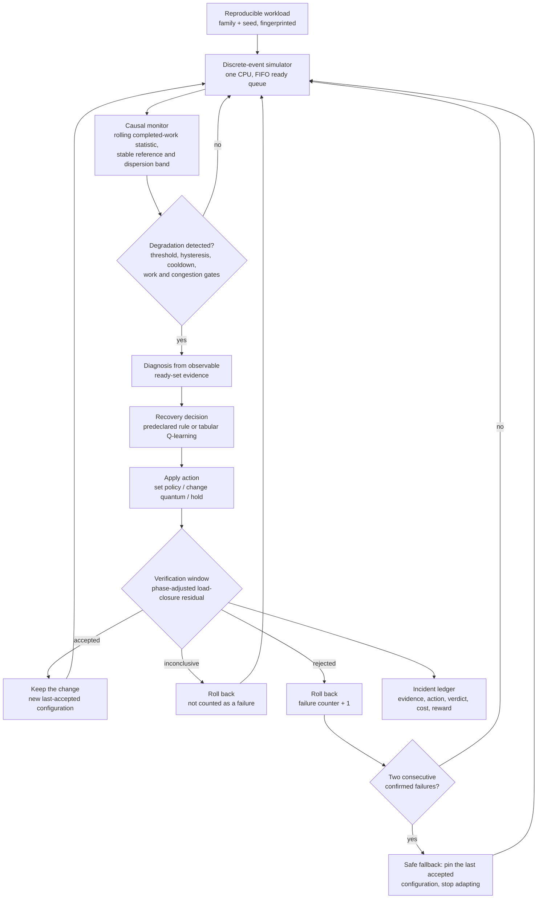

# Project Context: Adaptive CPU Scheduling Using Reinforcement Learning for Dynamic Workloads

> **Repository inspected:** 2026-10-16  
> **Current `main` commit:** `59b3939d7bb04bd1446c565c2307d90f073113ff` (2026-10-15 22:58:58 +0530)  
> **Repository URL:** <https://github.com/lostpilot404/OS-Project>

---

## Table of Contents

1. [At-a-Glance Overview](#1-at-a-glance-overview)
2. [Architecture Overview](#2-architecture-overview)
3. [Module-by-Module Architecture](#3-module-by-module-architecture)
4. [Technical Implementation](#4-technical-implementation)
5. [Experimental Design and Findings](#5-experimental-design-and-findings)
6. [Repository Structure and Development History](#6-repository-structure-and-development-history)
7. [Review 2 Submission Toolchain](#7-review-2-submission-toolchain)
8. [Known Limitations and Remaining Work](#8-known-limitations-and-remaining-work)
9. [Instructions for the Next AI Agent](#9-instructions-for-the-next-ai-agent)
10. [Source-of-Truth Hierarchy and Startup Checklist](#10-source-of-truth-hierarchy-and-startup-checklist)

---

## 1. At-a-Glance Overview

| Field | Value |
|---|---|
| **Official title** | **Adaptive CPU Scheduling Using Reinforcement Learning for Dynamic Workloads** |
| **Repository** | <https://github.com/lostpilot404/OS-Project> |
| **`main` SHA (verified)** | `59b3939d7bb04bd1446c565c2307d90f073113ff` (2026-10-15) |
| **Session branch** | `arena/7942b8bd-os-project` (branched from `main` at the above commit) |
| **Primary system** | Self-healing CPU scheduler (discrete-event simulator) |
| **Scope** | Synthetic, single-CPU simulation. No kernel module, no real OS, no real workloads. |
| **Primary command** | `python main.py healing-study` (~47 s) |
| **Test command** | `python -m pytest -q` (472 tests, ~38 s, all passing as of 2026-10-16) |
| **Canonical docs** | `docs/METHODOLOGY.md`, `docs/ARCHITECTURE.md`, `docs/EVALUATION_RESULTS.md`, `docs/LIMITATIONS.md` |
| **Review 2 deliverables** | `docs/Review_2_Report.docx` (editable), `docs/Review_2_Report.pdf` |
| **Report rebuild** | `python tools/build_review2_report.py` (PDF) / `python tools/build_review2_docx.py` (DOCX) |
| **Active PRs** | PR #8 (latest merged, cleanup + Review 2 report); PR #5 closed without merge (superseded) |
| **Python** | 3.11.2 |
| **Key dependencies** | NumPy 2.4.6, pandas 3.0.6, Matplotlib 3.11.2, pytest 9.1.1 |

### What this project is

A **self-healing CPU scheduler implemented inside a discrete-event simulator**. The system:

1. Runs a workload through an event-driven single-CPU simulator
2. Monitors realized waiting time from completed processes only
3. Detects degradation against a stable reference with threshold, hysteresis and cooldown
4. Diagnoses a cause from the visible ready-set composition
5. Selects one of 8 recovery actions (predeclared rule or tabular Q-learning)
6. Verifies the outcome over a declared observation window
7. Accepts the change, rolls it back, or enters safe fallback
8. Records every decision, its evidence, its cost, and its outcome in an incident ledger

### What this project is NOT

- Not a Linux/Windows kernel modification
- Not a real hardware measurement
- Not a real workload trace
- Not a claim that RL beats fixed SJF or any other fixed policy

### First things to read

For a new AI assistant joining this project, read in order:
1. **This file** (you are reading it)
2. `README.md` — quick overview with headline numbers
3. `docs/ARCHITECTURE.md` — module map and causal boundary
4. `docs/EVALUATION_RESULTS.md` — every number, traceable to artifacts
5. `docs/LIMITATIONS.md` — what is measured, assumed, and unverified

---

## 2. Architecture Overview

### Full Lifecycle



The entire loop is implemented in `healing/controller.py` (`SelfHealingController`).

### Observation Boundary

| **Controller CAN observe** | **Controller CANNOT see** |
|---|---|
| Ready set (arrived processes: arrival time, remaining burst, priority) | Unarrived processes |
| Completion notices (realized waiting times) | The full workload object |
| Configuration currently in force | The future event list |
| Its own past decisions | The finished schedule |

**Important caveat:** `RuntimeObservation` exposes exact burst times and remaining bursts for arrived processes. This is a simulator assumption — a real OS does not have this information. SJF (which relies on burst knowledge) and the diagnosis features both depend on this.

### State Machine

```mermaid
stateDiagram-v2
    [*] --> Idle: trace starts (FCFS)
    Idle --> Idle: within_band / insufficient_telemetry / cooldown / hysteresis_pending / gates block
    Idle --> Verifying: degradation_detected → action applied
    Verifying --> Accepted: residual ≥ +0.30 (verified improvement)
    Verifying --> Rejected: residual ≤ −0.30 (confirmed failure)
    Verifying --> Inconclusive: residual in (−0.30, +0.30) or thin/truncated evidence
    Accepted --> Idle: new last-accepted config becomes live
    Rejected --> Idle: roll back to last-accepted; consecutive_failures++
    Inconclusive --> Idle: roll back (declared safety posture); NOT a failure
    Rejected --> SafeFallback: 2 consecutive confirmed failures
    SafeFallback --> Idle: pinned config, no further adaptation this trace
```



---

## 3. Module-by-Module Architecture

### 3.1 Workload Models (`workload/`)

#### `workload/models.py`
- **Classes:** `Process`, `Workload`, `ScheduleResult`, `ProcessOutcome`, `ExecutionSlice`
- **Responsibility:** Data model for synthetic processes (pid, arrival_time, burst_time, priority), canonical workload ordering, schedule result construction
- **Key function:** `build_schedule_result()` — computes per-process outcomes from execution slices
- **Tests:** `tests/test_workload_models.py`, `tests/test_schedule_result.py`

#### `workload/generator.py`
- **Class:** `WorkloadGenerator`
- **Responsibility:** Generates synthetic workloads from `WorkloadFamilyConfig` definitions
- **Key method:** `generate(family_name, seed)` — deterministic from `(family, seed)` pair
- **Seeding:** All randomness via `numpy.random.default_rng(derive_seed(...))` — SHA-256-based, reproducible
- **Tests:** `tests/test_generator.py`

#### `workload/fingerprint.py`
- **Class:** `WorkloadFingerprint`
- **Function:** `fingerprint_workload(workload)` → content hash
- **Features:** 11 interpretable features (process_count, arrival_span, burst_cv, burst_skew, priority_burst_correlation, etc.)
- **Purpose:** Proves identical workloads across arms; used for pairing in bootstrap statistics
- **Tests:** `tests/test_fingerprint.py`

### 3.2 Event-Driven Simulation (`scheduler/`)

#### `scheduler/runtime.py` (PRIMARY engine)
- **Classes:** `RuntimeSimulator`, `RuntimeObservation`, `RuntimeActionDecision`, `RuntimeDecisionRecord`, `RuntimeRun`, `ObservedProcess`
- **Responsibility:** Single-CPU event-driven scheduler with causal controller boundary
- **Dispatch rules:** FCFS/RR = queue head; SJF = shortest remaining burst; Priority = highest priority. Ties preserve queue insertion order.
- **Protocol:** Controller receives `RuntimeObservation`, returns `RuntimeActionDecision` (action + optional quantum override)
- **Key invariant:** The workload, unarrived processes, and finished schedule are never passed to a controller method
- **Tests:** `tests/test_runtime_scheduler.py`, `tests/test_runtime_experiment.py`

#### `scheduler/base.py`
- **Classes:** `Timeline`, `SchedulingPolicy`, `NonPreemptiveReadyQueuePolicy`
- **Responsibility:** Shared infrastructure — execution slice management, policy interface

#### `scheduler/fcfs.py`, `sjf.py`, `round_robin.py`, `priority.py`
- **Responsibility:** Standalone reference implementations used as untouched baselines
- **Mapping:** `POLICY_CLASSES` dict in `scheduler/__init__.py`

### 3.3 Self-Healing Loop (`healing/`)

#### `healing/config.py`
- **Class:** `HealingConfig` — every declared threshold, frozen before the held-out run
- **Key fields:**
  - Monitoring: `window_completions=8`, `reference_ewma=0.35`, `band_ewma=0.25`
  - Detection: `threshold_band_multiplier=1.25`, `hysteresis_evaluations=2`, `cooldown_decisions=3`
  - Work gate: `min_ready_processes=2`, `min_remaining_work_factor=1.5`
  - Congestion gate: `min_load_factor=1.0`
  - Verification: `verify_decisions=5`, `verify_completions=3`, `verify_max_decisions=14`
  - Phase-aware baseline: `post_load_baseline=(-2.422506, -0.008145, 0.998700, -0.082333)`
  - Residual boundaries: `accept_residual_factor=0.30`, `reject_residual_factor=-0.30`
  - Safe fallback: `max_consecutive_failures=2`, `fallback_policy=ACTION_FCFS`
  - Reward: `intervention_cost=0.01`, `rollback_penalty=0.02`
- **Tests:** Config validated in `__post_init__`; exercised by all healing tests

#### `healing/monitor.py`
- **Class:** `CausalMonitor` — rolling completion-based performance statistic
- **Two statistics:**
  - `wait_window` — completed-process waiting times (for detection)
  - `load_window` — waiting-time accrual rate ΔW/Δt per decision interval (for verification)
- **Reference update rule:** Window is judged against reference it did NOT create; only non-suspect windows are absorbed via EWMA smoothing
- **Class:** `MonitorSnapshot` — immutable evidence object with all observable quantities
- **Tests:** `tests/test_healing_monitor.py`

#### `healing/detector.py`
- **Class:** `DegradationDetector`
- **Method:** `evaluate(monitor, ...) → DetectionOutcome`
- **Trigger conditions (all must hold):**
  1. Sufficient telemetry (≥ `min_window_completions`)
  2. Window mean > reference + k × band
  3. Hysteresis: `hysteresis_evaluations` consecutive suspect evaluations
  4. Cooldown elapsed since previous incident
  5. Adaptation enabled and budget not exhausted
  6. Queue congestion gate: load_level ≥ `min_load_factor` × load_reference
  7. Work gate: sufficient ready processes and remaining work
- **Returns explicit reason** for every suppressed evaluation
- **Tests:** `tests/test_healing_detector.py`, `tests/test_healing_detection.py`

#### `healing/diagnosis.py`
- **Function:** `build_ready_evidence(observation, ...) → ReadyEvidence`
- **Function:** `diagnose(evidence, snapshot, config) → Diagnosis`
- **Categories (fixed precedence):**
  1. `head_of_line_blocking` — head needs ≥ 4× median remaining burst
  2. `fairness_starvation` — oldest job age ≥ 3× reference wait
  3. `tail_dispersion` — worst wait ≥ 5× window median
  4. `priority_ordering_anomaly` — worse priority running while better work ready
  5. `queue_congestion` — ≥ 5 processes ready
  6. `unexplained` — no visible evidence matched
- **Tests:** `tests/test_healing_diagnosis.py`

#### `healing/actions.py`
- **8 actions:** HOLD(0), SET_FCFS(1), SET_SJF(2), SET_ROUND_ROBIN(3), SET_PRIORITY(4), SHRINK_QUANTUM(5), GROW_QUANTUM(6), REVERT_TO_LAST_ACCEPTED(7)
- **Class:** `SchedulerSettings(policy, quantum)`
- **Function:** `apply_healing_action()` — applies action, collapses no-op changes to HOLD
- **Key rule:** Action that cannot change the live config reports `changed=False` and is never counted as an intervention
- **Tests:** Implicit through healing experiment tests

#### `healing/policies.py`
- **Policies:**
  - `RuleHealingPolicy` — fairness-oriented diagnosis→action rule (predeclared)
  - `RuleWaitingTimePolicy` — waiting-time-oriented diagnosis→action rule (predeclared)
  - `HoldOnlyPolicy` — control arm, never intervenes
  - `QLearningHealingPolicy` — tabular Q-learning recovery controller
- **Context encoder:** `HealingContextEncoder` — 5 features × mixed-radix bins → 648 states
  - diagnosis(6) × excess(3) × ready_count(3) × current_policy(4) × remaining_work(3) = 648
  - With 8 actions: 5184 state-action pairs
- **Q-learning features:** epsilon-greedy, forced first-visit exploration, masked bootstrapping
- **Tests:** `tests/test_healing_policies.py`

#### `healing/verifier.py`
- **Function:** `verify(evidence, config) → VerificationVerdict`
- **Three verdicts:** `accepted`, `rejected`, `inconclusive` (plus `held` for non-interventions)
- **Phase-aware baseline:** Predicts no-action post-window load from trigger observables:
  - Features: `trigger_load`, `ready_count`, `log1p(visible_work)`
  - Coefficients: `(-2.422506, -0.008145, 0.998700, -0.082333)`
  - Residual spread: 0.160 (vs 0.806 for raw closure)
- **Boundaries:** Accept ≥ +0.30 (95th percentile of control residual), Reject ≤ −0.30 (5th percentile)
- **Critical property:** This is a **safety filter**, not a benefit estimator. Only ~6.7% of genuinely helpful interventions clear the accept boundary.
- **Tests:** `tests/test_healing_verification.py`

#### `healing/controller.py`
- **Class:** `SelfHealingController` — the state machine driving the full loop
- **Class:** `IncidentRecord` — wide record with full evidence trail for every incident
- **Class:** `EpisodeRecord` — aggregate record for one trace
- **Functions:** `replay_hold_counterfactual()`, `replay_action_at_incident()` — counterfactual replay
- **Safe fallback:** 2 consecutive confirmed failures → pin config, stop adapting
- **Tests:** `tests/test_healing_controller.py`, `tests/test_healing_experiment.py`

### 3.4 RL Agents (`rl/`)

#### `rl/q_learning.py`
- **Class:** `QLearningAgent` — tabular Q-learning with `EpsilonSchedule`
- **Supports:** Terminal (legacy) and non-terminal (runtime) transitions
- **Features:** State-action visit tracking, masked bootstrapping, epsilon-greedy

#### `rl/adaptive.py`
- **Class:** `AdaptivePolicySelector` — offline whole-workload Q-learning selector (LEGACY/preserved)

#### `rl/runtime_controller.py`, `rl/runtime_heuristic.py`, `rl/runtime_state.py`
- **Legacy** runtime adaptation modules (preserved, not the primary system)

#### Other `rl/` files
- `rl/selector.py` — offline selector
- `rl/state.py`, `rl/fingerprint_state.py` — state encoding for offline selector
- `rl/reward.py` — reward models for offline selector
- `rl/objective.py` — objective functions (risk-aware, original)
- `rl/explain.py` — decision explanations

### 3.5 Experiment Harness (`experiments/`)

#### `experiments/healing_config.py` (PRIMARY)
- **Class:** `HealingExperimentConfig` — frozen study design
- **Class:** `HealingArm` — one evaluated method
- **Key design:**
  - Training: seeds `7101`–`7105`, 1200 episodes each, 6 families (excl. `poisson_arrivals`)
  - Validation: seed `8201`, 20 reps/family (140 traces)
  - Final test: seed `23819`, 30 reps/family (210 traces)
  - Bootstrap: 1000 replicates, seed `104729`
  - Scheduler: `round_robin_quantum=4`, `switching_cost=1`
  - Q-learning: `discount_factor=1.0` (undiscounted episodic), `epsilon_decay=0.997`
- **Function:** `default_arms()` — predeclared arm list (14+ arms)

#### `experiments/healing_experiment.py` (PRIMARY)
- **Function:** `run_healing_experiment()` — the primary experiment pipeline
- **Three analyses:**
  1. Detection summary (verdict counts per arm)
  2. Counterfactual replay audit (matched hold + hold-forever)
  3. Action-effect probe (validation split)

#### `experiments/healing_thresholds.py`
- Derives verification thresholds from training control data

#### `experiments/healing_detection.py`
- Detector scenario evaluation (injected degradations on validation split)

#### Preserved (non-primary) workflows:
- `experiments/study.py` + `experiments/study_config.py` — offline policy-selection study
- `experiments/runtime_experiment.py` + `experiments/runtime_config.py` — runtime adaptation appendix
- `experiments/train.py`, `evaluate.py`, `report.py`, `run_experiment.py` — legacy offline pipeline
- `experiments/baselines.py` — shared baseline helpers

### 3.6 Evaluation (`evaluation/`)

- `evaluation/metrics.py` — `WorkloadMetrics`, `compute_metrics()` (6 standard metrics)
- `evaluation/paired.py` — `paired_bootstrap_difference()` — family-stratified crossed bootstrap
- `evaluation/counterfactual.py` — `run_counterfactuals()`, `selection_regret()` (offline selector)
- `evaluation/comparison.py` — comparison helpers

### 3.7 Visualization (`visualization/`)

- `visualization/healing_plots.py` — figures for healing study (`healing_waiting_time.png`, etc.)
- `visualization/study_plots.py` — figures for offline study
- `visualization/plots.py` — figures for legacy pipeline

### 3.8 CLI (`main.py`)

**Commands and flags:**

| Command | Description | Output |
|---|---|---|
| `healing-study` (default) | Primary self-healing study | `results/healing/`, `figures/healing/` |
| `study` | Preserved offline policy-selection study | `results/study/`, `figures/study/` |
| `runtime-experiment` | Preserved non-healing runtime appendix | `results/runtime/` |
| `experiment` | Preserved legacy offline pipeline | `results/` (on demand, not tracked) |
| `train` | Preserved legacy training only | Console output |

**Shared flags:** `--results-dir DIR`, `--figures-dir DIR`, `--no-figures`, `--no-probe`

---

## 4. Technical Implementation

### 4.1 Python Version and Dependencies

| Component | Version |
|---|---|
| Python | 3.11.2 |
| NumPy | 2.4.6 |
| pandas | 3.0.6 |
| Matplotlib | 3.11.2 |
| pytest | 9.1.1 |

**Report generation extras:** reportlab 5.0.1, python-docx 1.2.0

### 4.2 Installation

**Linux/macOS:**
```bash
python3 -m venv .venv
.venv/bin/python -m pip install -r requirements.lock
```

**Windows:**
```bat
py -3.11 -m venv .venv
.venv\Scripts\python -m pip install -r requirements.lock
```

**For report generation:**
```bash
.venv/bin/python -m pip install -r requirements-report.txt
```

### 4.3 Running the Project

```bash
# Primary experiment (all evidence):
.venv/bin/python main.py healing-study

# Reproduce without touching committed artifacts:
.venv/bin/python main.py healing-study \
    --results-dir /tmp/healing-results --figures-dir /tmp/healing-figures

# Tests:
.venv/bin/python -m pytest -q

# Report generation:
.venv/bin/python tools/build_review2_report.py     # → docs/Review_2_Report.pdf
.venv/bin/python tools/build_review2_docx.py       # → docs/Review_2_Report.docx
```

### 4.4 Configuration Files

| File | Purpose |
|---|---|
| `config.py` | Shared config for legacy schedulers, workload families, Q-learning, actions |
| `healing/config.py` | Frozen healing loop thresholds (all declared in one place) |
| `experiments/healing_config.py` | Frozen study design (seeds, splits, arms, hyperparameters) |
| `experiments/runtime_config.py` | Runtime experiment configuration |
| `experiments/study_config.py` | Offline study configuration |
| `requirements.txt` | Runtime + test dependencies |
| `requirements-report.txt` | Extra deps for report generation |
| `requirements.lock` | Fully pinned environment |

### 4.5 Workload Families

7 families defined in `config.py` `build_default_config()`:

| Family | Arrival | Burst | Description |
|---|---|---|---|
| `short_jobs` | uniform(0,20) | bimodal(80% short 1-5) | Short-job heavy |
| `long_jobs` | uniform(0,20) | bimodal(20% short 1-5) | Long-job heavy |
| `mixed` | uniform(0,20) | uniform(1,50) | Uniform mix |
| `cpu_bursty` | uniform(0,15) | uniform(20,50) | Dense long bursts |
| `priority_skewed` | uniform(0,20) | uniform(1,50) | 70% priorities in 1-2 |
| `staggered_interactive` | staggered(4-6) | one long + 14 short | Head-of-line demo |
| `poisson_arrivals` | Poisson(λ=0.5) | uniform(1,20) | Distribution-shift test (held out of training) |

### 4.6 Seed Derivation

All randomness flows through `config.derive_seed(base_seed, *components)` using SHA-256:
```python
payload = ":".join(str(v) for v in (base_seed, *components))
digest = hashlib.sha256(payload.encode()).digest()
return int.from_bytes(digest[:8], "big") >> 1
```

Split tags ensure disjoint streams: `training=51`, `validation=67`, `final_test=83`.

### 4.7 Action Space and State Representation

**Action space (8 actions):**

| Index | Name | Effect |
|---|---|---|
| 0 | `hold` | No change |
| 1 | `set_fcfs` | Switch to FCFS |
| 2 | `set_sjf` | Switch to SJF |
| 3 | `set_round_robin` | Switch to Round Robin |
| 4 | `set_priority` | Switch to Priority |
| 5 | `shrink_quantum` | Halve RR quantum (only under RR) |
| 6 | `grow_quantum` | Double RR quantum (only under RR) |
| 7 | `revert_to_last_accepted` | Undo last accepted change |

**State representation (648 states):**
- Diagnosis: 6 bins (from diagnosis categories)
- Excess: 3 bins (< 1.5k, < 2.5k, ≥ 2.5k band widths)
- Ready count: 3 bins (1-2, 3-4, 5+)
- Current policy: 4 bins (FCFS, SJF, RR, Priority)
- Remaining work ratio: 3 bins (< 3, < 8, ≥ 8 multiples of reference wait)

**Reward:** Verified relative improvement in waiting-time statistic minus intervention cost (1% of reference wait) minus rollback penalty (2%) for confirmed failures.

### 4.8 Result Artifacts

**`results/healing/` (21 files, committed evidence):**

| Category | Files |
|---|---|
| Metrics | `healing_metrics_final_test.csv`, `healing_metrics_validation.csv` |
| Comparisons | `healing_comparisons.csv` |
| Episodes | `healing_episodes_final_test.csv`, `healing_episodes_validation.csv`, `healing_training_episodes.csv` |
| Incidents | `healing_incidents_final_test.csv`, `healing_incidents_validation.csv`, `healing_control_incidents.csv` |
| Audit | `healing_audit.csv` |
| Coverage | `healing_coverage.csv`, `healing_coverage_curve.csv` |
| Detection | `healing_detection_scenarios.csv`, `healing_detection_summary.csv` |
| Thresholds | `healing_threshold_derivation.csv`, `healing_verification_models.csv` |
| Probe | `healing_action_probe.csv` |
| Q-learning | `healing_q_seed_variability.csv` |
| Summary | `healing_summary.json`, `healing_report.md`, `healing_demo.json` |

**Key JSON artifact: `healing_summary.json`**
- Contains: arm means, audit summary, coverage per seed, threshold derivation, verification discrimination, software versions, experiment configuration
- Every number in `docs/EVALUATION_RESULTS.md` is derived from this file

### 4.9 Test Organization

472 tests across ~30 test files in `tests/`:

| Category | Test files |
|---|---|
| Schedulers | `test_fcfs.py`, `test_sjf.py`, `test_round_robin.py`, `test_priority.py` |
| Runtime engine | `test_runtime_scheduler.py`, `test_runtime_experiment.py` |
| Healing loop | `test_healing_controller.py`, `test_healing_monitor.py`, `test_healing_detector.py`, `test_healing_detection.py`, `test_healing_diagnosis.py`, `test_healing_policies.py`, `test_healing_verification.py`, `test_healing_experiment.py` |
| RL agents | `test_q_learning.py`, `test_adaptive.py`, `test_selector.py`, `test_reward.py`, `test_state.py`, `test_fingerprint.py` |
| Experiments | `test_experiments.py`, `test_experiment_design.py`, `test_study_design.py` |
| Workload | `test_generator.py`, `test_workload_models.py` |
| Evaluation | `test_metrics.py`, `test_counterfactual.py`, `test_objective.py`, `test_output_validation.py` |
| Reproducibility | `test_reproducibility.py` |
| Other | `test_schedule_result.py`, `test_explanations.py`, `helpers.py` |

---

## 5. Experimental Design and Findings

### 5.1 Experimental Setup

- **Training:** 5 seeds (`7101`–`7105`), 1200 episodes each, 6 families (excl. `poisson_arrivals`)
- **Validation:** seed `8201`, 140 traces (20 per family × 7 families)
- **Final test:** seed `23819`, 210 traces (30 per family × 7 families)
- **Bootstrap:** 1000 replicates, seed `104729`
- **Scheduler config:** `round_robin_quantum=4`, `switching_cost=1`
- **Q-learning:** `discount_factor=1.0`, `lr=0.1`, `epsilon_start=1.0`, `epsilon_min=0.05`, `decay=0.997`

### 5.2 Arms Evaluated

| Arm | Kind | Description |
|---|---|---|
| `fixed_fcfs` | Fixed | Standalone FCFS |
| `fixed_sjf` | Fixed | Standalone SJF |
| `fixed_round_robin` | Fixed | Standalone Round Robin |
| `fixed_priority` | Fixed | Standalone Priority |
| `detector_only` | Healing (hold) | Full loop, never intervenes |
| `rule_fairness` | Healing (rule) | Predeclared fairness-oriented rule |
| `rule_wait` | Healing (rule) | Predeclared waiting-time-oriented rule |
| `rule_wait_from_sjf` | Healing (rule) | Waiting-time rule from SJF start |
| `q_recovery` (×5) | Healing (Q-learning) | Tabular Q-learning, one per seed |
| `q_recovery_from_sjf` (×5) | Healing (Q-learning) | Q-learning from SJF start |

### 5.3 Headline Results (Final-Test Seed 23819)

**Mean waiting time** (simulated time units, lower is better):

| Arm | Mean wait | P95 wait |
|---|---:|---:|
| `fixed_sjf` | **94.66** | **249.20** |
| `q_recovery_from_sjf` (5 seeds) | 94.66 | 249.20 |
| `rule_wait` | 122.39 | 251.88 |
| `q_recovery` (5 seeds) | 122.56 | 251.98 |
| `fixed_priority` | 128.32 | 262.75 |
| `detector_only` (= `fixed_fcfs`) | 130.84 | 258.42 |
| `rule_fairness` | 136.78 | 263.72 |
| `fixed_round_robin` | 217.05 | 310.41 |

### 5.4 Paired Bootstrap Comparisons

Family-stratified crossed bootstrap, 1000 replicates, seed `104729`:

| Target | Reference | Difference | 95% CI |
|---|---|---:|---|
| `rule_wait` | `detector_only` | **−8.45** | [−9.44, −7.35] |
| `q_recovery` | `fixed_fcfs` | **−8.27** | [−9.31, −7.20] |
| `q_recovery` | `rule_wait` | +0.18 | [−0.04, +0.48] |
| `rule_wait` | `fixed_sjf` | +27.73 | [+26.05, +29.72] |
| `q_recovery` | `fixed_sjf` | +27.91 | [+26.11, +29.87] |
| `rule_fairness` | `fixed_fcfs` | +5.94 | [+4.38, +7.45] |
| `q_recovery_from_sjf` | `fixed_sjf` | 0.00 | [0.00, 0.00] |

**Key findings:**
- Recovery **beats doing nothing** (−8.45 wait units vs control)
- Learning is **not distinguishable from the rule** (+0.18, CI includes zero)
- Neither recovery method **reaches fixed SJF** (+27.73–27.91)
- From SJF start, the loop is **inert** (0 interventions)

### 5.5 Counterfactual Audit

Matched replay: same controller, same workload, one incident forced to hold.

| Arm | Audited | Helpful | False recoveries |
|---|---:|---:|---:|
| `q_recovery` | 678 | 644 (95.0%) | 34 (5.0%) |
| `rule_wait` | 141 | 133 (94.3%) | 8 (5.7%) |
| `rule_fairness` | 150 | 35 (23.3%) | 115 (76.7%) |
| `rule_wait_from_sjf` | 4 | 0 (0%) | 4 (100%) |

Mean marginal gain per intervention:
- `rule_wait`: +188.79 wait units
- `q_recovery`: +192.07 wait units
- `rule_fairness`: −130.84 wait units

### 5.6 Verification Limitations

- **Verifier accepted 65 interventions**, all helpful (base rate 83.9%)
- But only **6.7% of genuinely helpful interventions** clear the accept boundary
- **91.0–92.1%** end inconclusive and are rolled back
- The verifier is a **safety filter**, not a benefit estimator
- Rank AUC of the residual: 0.951 for discriminating helpful from harmful

### 5.7 Q-Learning Coverage

- 1200 traces per seed visit **29–33 of 648 states** (4.5–5.1%)
- Only **56–66 of 5184 state-action pairs** are visited (1.1–1.3%)
- Coverage curve is flat after ~900 episodes
- 9.1–13.8% of decisions fall back to initial values (unseen contexts)
- The state space is larger than the training event supply

### 5.8 What These Findings Do and Do Not Support

**Supported:**
- The healing loop beats doing nothing (detection-only control) on these workloads
- Recovery actions themselves are useful (counterfactual audit confirms)
- The verifier correctly filters: accepted interventions genuinely helped
- Starting from SJF, the loop does no harm

**NOT supported:**
- RL does NOT beat fixed SJF
- RL is NOT distinguishable from the hand-written rule
- No real OS performance claims can be made
- Results are conditional on the declared design (5 training seeds, 7 families, fixed repetitions)

---

## 6. Repository Structure and Development History

### 6.1 Repository Tree

```
OS-Project/
├── config.py              # Shared config (families, Q-learning, scheduler)
├── errors.py              # Exception types
├── main.py                # CLI entry point
├── pytest.ini             # Test configuration
├── requirements.txt       # Runtime + test deps
├── requirements-report.txt # Report generation extras
├── requirements.lock      # Fully pinned environment
├── .gitignore
├── README.md
├── healing/               # PRIMARY: self-healing loop
│   ├── __init__.py
│   ├── config.py          # Frozen thresholds
│   ├── monitor.py         # Causal performance monitoring
│   ├── detector.py        # Degradation detection
│   ├── diagnosis.py       # Evidence-backed diagnosis
│   ├── actions.py         # 8-action recovery space
│   ├── policies.py        # Rule + Q-learning + hold policies
│   ├── verifier.py        # Tri-state verification
│   └── controller.py      # State machine + incident ledger
├── scheduler/             # Event-driven engine + baselines
│   ├── __init__.py
│   ├── base.py            # Timeline, SchedulingPolicy
│   ├── runtime.py         # RuntimeSimulator (primary engine)
│   ├── fcfs.py, sjf.py, round_robin.py, priority.py
├── workload/              # Workload models + generation
│   ├── __init__.py
│   ├── models.py          # Process, Workload, ScheduleResult
│   ├── generator.py       # WorkloadGenerator
│   └── fingerprint.py     # Content fingerprinting
├── rl/                    # RL agents (legacy + runtime)
│   ├── __init__.py
│   ├── q_learning.py      # Tabular Q-learning agent
│   ├── adaptive.py        # Offline selector (preserved)
│   ├── runtime_controller.py, runtime_heuristic.py, runtime_state.py
│   ├── selector.py, state.py, fingerprint_state.py
│   ├── reward.py, objective.py, explain.py
├── experiments/           # Experiment harnesses
│   ├── __init__.py
│   ├── healing_config.py  # PRIMARY: frozen study design
│   ├── healing_experiment.py  # PRIMARY: study runner
│   ├── healing_thresholds.py  # Threshold derivation
│   ├── healing_detection.py   # Detector scenarios
│   ├── study.py, study_config.py  # Preserved offline study
│   ├── runtime_experiment.py, runtime_config.py  # Preserved runtime
│   ├── train.py, evaluate.py, report.py, run_experiment.py  # Legacy
│   └── baselines.py
├── evaluation/            # Metrics and statistics
│   ├── __init__.py
│   ├── metrics.py         # 6 standard metrics
│   ├── paired.py          # Bootstrap statistics
│   ├── counterfactual.py  # Offline counterfactuals
│   └── comparison.py
├── visualization/         # Figure generation
│   ├── __init__.py
│   ├── healing_plots.py
│   ├── study_plots.py
│   └── plots.py
├── tests/                 # 472 tests
│   ├── helpers.py
│   ├── test_healing_*.py  # 8 healing test files
│   ├── test_runtime_*.py  # 2 runtime test files
│   ├── test_*.py          # ~20 other test files
├── results/
│   ├── healing/           # PRIMARY: 21 committed artifacts
│   ├── study/             # Preserved offline study results
│   └── runtime/           # Preserved runtime results
├── figures/
│   ├── healing/           # 3 study figures
│   ├── study/             # 5 offline study figures
│   └── review2/           # 16 report figures
├── docs/
│   ├── ARCHITECTURE.md
│   ├── METHODOLOGY.md
│   ├── EVALUATION_RESULTS.md
│   ├── LIMITATIONS.md
│   ├── DESIGN_AND_CHOICES.md
│   ├── APPENDIX_RUNTIME_SIMULATOR.md
│   ├── Review_2_Report.pdf  # Canonical PDF
│   └── Review_2_Report.docx # Canonical editable DOCX
└── tools/                 # Report toolchain
    ├── build_review2_report.py  # PDF builder
    ├── build_review2_docx.py    # DOCX builder
    ├── review2_content.py       # Narrative source
    ├── review2_layout.py        # Page furniture
    ├── review2_data.py          # Artifact reader
    └── review2_figures.py       # Figure renderer
```

### 6.2 Primary vs. Historical Modules

| Category | Modules | Status |
|---|---|---|
| **Primary system** | `healing/`, `experiments/healing_*` | Active, reported evidence in `results/healing/` |
| **Preserved comparison** | `rl/adaptive.py`, `experiments/study.py` | Not the primary system; results in `results/study/` |
| **Preserved appendix** | `experiments/runtime_experiment.py` | Non-healing runtime; results in `results/runtime/` |
| **Legacy pipeline** | `experiments/{train,evaluate,report,run_experiment}.py` | Generated on demand, not tracked in Git |
| **Simulation engine** | `scheduler/runtime.py` | Shared by primary and preserved systems |

### 6.3 GitHub PR History

| PR | Title | Branch | Status | Date |
|---|---|---|---|---|
| #8 | Reconcile cleanup with Review 2 report | `arena/c2789177-os-project` | **MERGED** | 2026-10-15 |
| #7 | Repair self-healing study (verification fix, frozen run) | `arena/befa2b94-os-project` | **MERGED** | 2026-10-15 |
| #6 | Offline, explainable, risk-aware scheduling | `arena/dc7cf418-os-project` | **MERGED** | 2026-10-15 |
| #5 | Review 2 report PDF | `arena/5e0b2eac-os-project` | **CLOSED** (superseded) | 2026-10-10 |
| #4 | Add Review 2 technical report PDF | `arena/dd6436c4-os-project` | **MERGED** | 2026-10-10 |
| #3 | Arena session | `arena/052bdc43-os-project` | **MERGED** | 2026-10-09 |
| #2 | Arena session | `arena/7fa3a133-os-project` | **MERGED** | 2026-10-08 |
| #1 | Arena session | `arena/87f3bb24-os-project` | **MERGED** | 2026-10-08 |

Current branch: `arena/7942b8bd-os-project` (this session)

### 6.4 Retired Seeds (MUST NOT BE REUSED)

| Seed | Reason |
|---|---|
| `9401` | Used while harness was built |
| `20501` | Touched by early smoke run before congestion gate |
| `20719` | Evaluated once, then verification rule was reworked |
| `21617` | Used during development of repaired loop |
| `72601` | Touched by audit/coverage development |
| `21977` | Examined while structural phase baseline was chosen |

The current frozen held-out seed is `23819`.

### 6.5 Reproducibility

- Pipeline is **deterministic**: two independent runs produce byte-identical 21 artifacts + 3 figures
- Legacy pipeline output is byte-reproducible in ~8 seconds (`python main.py experiment`)
- All randomness is seeded through `derive_seed()` with SHA-256

---

## 7. Review 2 Submission Toolchain

### 7.1 Deliverables

| File | Description |
|---|---|
| `docs/Review_2_Report.pdf` | Canonical PDF report |
| `docs/Review_2_Report.docx` | Editable DOCX (same content, includes Mermaid source) |

### 7.2 Source Files

| File | Role |
|---|---|
| `tools/review2_content.py` | **Narrative source of truth** — all text, tables, interpretations |
| `tools/review2_layout.py` | Page furniture, styles, report title/URL |
| `tools/review2_figures.py` | Renders every figure from artifacts |
| `tools/review2_data.py` | Reads artifacts into structured `Artifacts` object |
| `tools/build_review2_report.py` | PDF builder (ReportLab) |
| `tools/build_review2_docx.py` | DOCX builder (python-docx) |

### 7.3 Build Commands

```bash
# Install report dependencies:
.venv/bin/python -m pip install -r requirements-report.txt

# Build PDF:
.venv/bin/python tools/build_review2_report.py
# → docs/Review_2_Report.pdf

# Build DOCX:
.venv/bin/python tools/build_review2_docx.py
# → docs/Review_2_Report.docx

# Fast iteration (skip tests):
.venv/bin/python tools/build_review2_report.py --skip-tests
```

### 7.4 Report Content

The report addresses the Review 2 rubric:
1. Architecture and module workflows
2. Methodology (objectives, workloads, metrics, statistics)
3. Experimental design (arms, splits, seeds)
4. Results (held-out comparison, bootstrap CIs, counterfactual audit)
5. Implementation evidence (code structure, tests, reproducibility)
6. Limitations (simulator scope, measured weaknesses, unverified claims)
7. Workloads and data collection
8. Tools and infrastructure
9. References

Figures live in `figures/review2/` (16 files) and are regenerated from committed artifacts.

---

## 8. Known Limitations and Remaining Work

### 8.1 Research Limitations (Measured, Reported)

1. **The loop does not beat fixed SJF** — mean wait 94.66 vs 122.39–122.56
2. **RL is indistinguishable from the rule** — paired diff +0.18, CI [−0.04, +0.48]
3. **Verifier certifies only ~6.7% of helpful interventions** — it's a safety filter
4. **91–92% of helpful interventions are inconclusive** and get rolled back
5. **Detector has false-trigger rate** of 0.62–0.65 events/trace on the control
6. **Detector recall** is 75.0% (burst shock) / 56.4% (arrival storm)
7. **Q-learning is undertrained** — 29–33 of 648 states visited, coverage flat after ~900 episodes
8. **Fairness rule is empirically wrong** — 76.7% false recoveries, mean −130.8 per intervention
9. **Reward correlation with true effect is weak** — Pearson 0.10 across traces, rank 0.622 within

### 8.2 Simulator Assumptions

- Burst times are **visible** to the scheduler (unrealistic)
- Single CPU, single FIFO queue, no I/O, no interrupts, no multicore
- Stationary arrivals within a trace
- Constant switching cost (1 time unit)
- No cache/NUMA effects, no page faults

### 8.3 Technical Debt and Known Issues

- **No CI pipeline** — tests must be run manually
- **No type checking enforcement** (mypy is not configured)
- **Legacy modules** (`rl/adaptive.py`, `experiments/study.py`) are preserved but not the primary system
- Legacy pipeline output is not committed (generated on demand)
- Report generation requires extra dependencies (`requirements-report.txt`)

### 8.4 What is NOT Verified

- Real OS performance
- Multi-core scheduling
- I/O-bound workloads
- Non-stationary traffic patterns
- Predictor error on burst times
- Comparison against CFS, EEVDF, or other real schedulers

### 8.5 Completed Work

- ✅ Self-healing loop fully implemented and tested
- ✅ Frozen held-out evaluation on seed 23819
- ✅ Counterfactual audit of all interventions
- ✅ Phase-aware verification rule derived and validated
- ✅ 472 tests all passing
- ✅ Review 2 report generated (PDF + DOCX)
- ✅ All documentation written (architecture, methodology, evaluation, limitations)
- ✅ Pipeline verified byte-for-byte reproducible

### 8.6 Possible Next Steps (Ordered by Importance)

1. **User decisions** — what does the user want to do next? The research findings are honest and complete for the current design.
2. If improving RL performance: reduce state space or increase training budget (but this requires new held-out seeds)
3. If adding CI: set up GitHub Actions for pytest
4. If extending the simulator: add I/O modeling, multi-core, or burst predictors (but this invalidates all current results)
5. Documentation improvements are minor — the current docs are thorough

---

## 9. Instructions for the Next AI Agent

> **READ THIS SECTION BEFORE PROPOSING ANY CHANGES.**

### Mandatory Rules

1. **Read this context file first.** Understand the project before touching anything.

2. **Fetch the current GitHub state before editing.** Run `git log -1` and `gh pr list` to verify the repo state matches what this file describes.

3. **Live source code and verified artifacts are authoritative.** When this file conflicts with what you find in the repo, trust the repo. This file may become stale.

4. **Preserve the exact official project title:** "Adaptive CPU Scheduling Using Reinforcement Learning for Dynamic Workloads"

5. **Do NOT change these without explicit reason and fresh validation:**
   - Seeds (training 7101–7105, validation 8201, final test 23819, bootstrap 104729)
   - Experiment definitions (arms, families, splits)
   - Frozen held-out results (everything in `results/healing/`)
   - Thresholds and reward logic
   - Research behaviour (the healing loop's semantics)

6. **Never claim tests or commands passed without actually running them.** Run `python -m pytest -q` and `python main.py healing-study` and verify the output.

7. **Keep research comparisons honest:**
   - RL does NOT beat fixed SJF
   - RL is NOT distinguishable from the rule-based controller
   - These are negative results and must be preserved
   - Do not reframe, soften, or reinterpret these findings

8. **Avoid unnecessary refactors.** The codebase is stable and well-tested. Do not rename, restructure, or "clean up" without a specific reason tied to a user request.

9. **Never delete evidence.** Everything in `results/` and `figures/` is committed evidence. Do not overwrite frozen artifacts.

10. **Inspect PRs and branches before committing or pushing.** Check `gh pr list` and `git branch -a` first.

11. **Never force-push, overwrite user work, or merge a PR without authorization.**

12. **Work directly on requested objectives.** Do not repeatedly ask the user to restate established context. The answer is in this file or the code.

13. **Report exact details:**
    - Changed files
    - Test results (count and time)
    - Commit SHAs
    - Any unresolved issues or uncertainties

### What This Project Needs

- Honest reporting of results (already done)
- User direction on what to do next
- No surprises, no hidden changes, no reinterpretation of findings

---

## 10. Source-of-Truth Hierarchy and Startup Checklist

### Source-of-Truth Hierarchy

When information conflicts, trust in this order:

1. **Live source code** in the repository (always authoritative)
2. **Committed artifacts** in `results/healing/` and `figures/` (frozen evidence)
3. **`docs/EVALUATION_RESULTS.md`** (derived from artifacts, checked against them)
4. **`README.md`** (headline numbers, matches docs)
5. **This file** (`PROJECT_CONTEXT.md`) (comprehensive but may become stale)
6. **Git history and PR descriptions** (development narrative)

### Startup Checklist for a New Agent

```bash
# 1. Verify repository state
git log -1 --format="%H %ai %s"
git branch -a
gh pr list --state all

# 2. Run tests
.venv/bin/python -m pytest -q
# Expected: 472 passed

# 3. Verify primary experiment is reproducible
.venv/bin/python main.py healing-study \
    --results-dir /tmp/verify-results --figures-dir /tmp/verify-figures

# 4. Read the key documentation
cat README.md
cat docs/ARCHITECTURE.md
cat docs/EVALUATION_RESULTS.md | head -100
cat docs/LIMITATIONS.md | head -100

# 5. Understand the frozen evidence
cat results/healing/healing_summary.json | python -m json.tool | head -50
```

### Quick Reference

| Question | Where to look |
|---|---|
| How does the healing loop work? | `healing/controller.py`, `docs/ARCHITECTURE.md` |
| What are the results? | `docs/EVALUATION_RESULTS.md`, `results/healing/healing_summary.json` |
| What are the limitations? | `docs/LIMITATIONS.md` |
| How do I run it? | `README.md`, `main.py --help` |
| How do I build the report? | `tools/build_review2_report.py --help` |
| What are the thresholds? | `healing/config.py` (all declared in one place) |
| What is the study design? | `experiments/healing_config.py` |
| What tests exist? | `tests/` directory, 472 tests |

---

*This file was generated on 2026-10-16 by inspecting the repository at commit `59b3939d7bb04bd1446c565c2307d90f073113ff`. It is a handoff document for AI assistants. The repository is the source of truth.*
