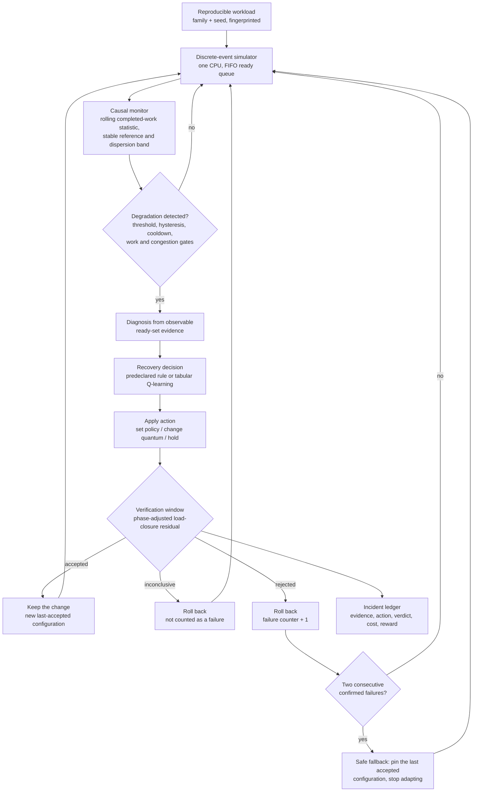

# Adaptive CPU Scheduling Using Reinforcement Learning for Dynamic Workloads

**Project system: a self-healing CPU scheduler.** A discrete-event simulator runs a
reproducible workload trace, monitors the performance the scheduler actually achieves,
declares a *degradation event* when realized waiting time rises above the trace's own stable
behaviour, diagnoses a likely cause from observable evidence, asks a recovery controller
(a predeclared rule or a tabular Q-learning agent) for one recovery action, applies it,
verifies the outcome over a declared observation window, and then **accepts, rolls back or
falls back** to a safe configuration — recording every decision, its evidence, its cost and
its outcome in an incident ledger.

> **Scope.** This is a **synthetic, discrete-event simulation study**, not a kernel
> modification. There is no Linux/Windows kernel module, no syscall, no real hardware
> measurement and no real workload trace. "Waiting time", "context switch" and "CPU
> utilization" below are simulator quantities, and the simulator grants the scheduler burst
> knowledge that a real operating system does not have. See
> [`docs/LIMITATIONS.md`](docs/LIMITATIONS.md).

## Quick lecturer demo and WSL2 setup

Follow [the exact WSL2 Ubuntu setup](docs/WSL_SETUP.md), including selection of the
recorded Python 3.11.2 interpreter rather than assuming Ubuntu's default Python.
After installing `requirements.lock` in the activated environment:

```bash
python main.py demo
```

This executes two small deterministic **real self-healing rule** fixtures, prints
observations, scheduling segments, incidents, verification and measured metrics, and
saves `results/demo/demo.json`. It does **not** train Q-learning or rerun the study.
Do not omit `demo`: the no-command default launches the full research workflow.

- [5–8 minute lecturer script](docs/DEMO_SCRIPT_FOR_LECTURER.md).
- [New final academic report source](docs/OS_Project_Final_Report.md) and
  [plain black-and-white PDF](docs/OS_Project_Final_Report.pdf).
- [Actual captured Linux output](docs/examples/demo_linux_output.txt).
- [Audit](docs/FINALIZATION_AUDIT.md) and [delivery checks](docs/FINAL_DELIVERY_CHECKS.md).

Finalization tests on Debian 12/Python 3.11.2: **500 passed, one existing plotting
warning**. Actual execution inside Windows WSL remains unverified. The frozen
research study was not rerun and its artifacts remain unchanged.

## How the self-healing loop works



The ten stages are implemented in one place, `healing/controller.py`: generate → simulate →
monitor → detect → diagnose → select action → apply → verify → accept/rollback/fallback →
record. Everything the controller sees is causal: the ready set of *arrived* processes, the
completions of the last decision interval, and its own past decisions. The workload object,
future arrivals and the finished schedule are never visible to it.

**What it observes:** the ready set (arrival times, remaining bursts, priorities), completion
notices, and the configuration in force.
**What it controls:** one configuration — the dispatch policy (FCFS, SJF, Round Robin,
Priority) and the Round-Robin quantum.

## Primary system vs. preserved workflows

| Workflow | Command | Role |
|---|---|---|
| **Self-healing scheduler study** (`healing/`, `experiments/healing_*`) | `main.py healing-study` | **Primary system**: training, held-out evaluation, counterfactual audit, coverage analysis, figures |
| Offline policy-selection study (`rl/adaptive.py`, `experiments/study.py`) | `main.py study` | Preserved comparison workflow: one policy chosen per whole workload before execution, with no reaction, verification or rollback. Artifacts in `results/study/` |
| Runtime simulator appendix (`experiments/runtime_experiment.py`) | `main.py runtime-experiment` | Preserved non-healing runtime experiment. Artifacts in `results/runtime/` |
| Legacy offline pipeline (`experiments/{train,evaluate,report,run_experiment}.py`) | `main.py experiment`, `main.py train` | Preserved for compatibility; its output is generated on demand and not tracked |

## Setup

Tested with **Python 3.11** (recorded environment: CPython 3.11.2 with NumPy 2.4.6,
pandas 3.0.6, Matplotlib 3.11.2, pytest 9.1.1). Dependencies are NumPy, pandas, Matplotlib and
pytest; `requirements.lock` pins the exact resolved environment.

Linux / macOS:

```bash
python3 -m venv .venv
.venv/bin/python -m pip install -r requirements.lock
```

Windows (PowerShell or `cmd`):

```bat
py -3.11 -m venv .venv
.venv\Scripts\python -m pip install -r requirements.lock
```

Any interpreter that already has these packages can also run the project directly
(`python main.py ...`); the examples below use the virtual environment created above.

## Run

```bash
# Primary system: full self-healing study (training, held-out evaluation, audit, figures).
# Writes results/healing/ and figures/healing/; takes about 47 s.
.venv/bin/python main.py healing-study

# Preserved workflows
.venv/bin/python main.py study                # offline policy-selection study
.venv/bin/python main.py runtime-experiment   # non-healing runtime appendix
.venv/bin/python main.py experiment           # legacy offline pipeline
```

Primary-command flags: `--results-dir DIR`, `--figures-dir DIR`, `--no-figures`,
`--no-probe`. To reproduce the study without touching the committed artifacts:

```bash
.venv/bin/python main.py healing-study \
    --results-dir /tmp/healing-results --figures-dir /tmp/healing-figures
```

Tests (500 passed in 38.37 s on the finalization Linux host; timing is host-dependent):

```bash
.venv/bin/python -m pytest -q
```

## Repository layout

```
config.py            shared configuration (workload families, Q-learning, scheduler)
main.py              command-line entry point (primary system + preserved workflows)
healing/             the self-healing loop: config, monitor, detector, diagnosis, actions,
                     policies, verifier, controller (state machine + incident ledger),
                     canonical reward computation (reward.py) and the single-source
                     canonical numbers quoted by the docs (canonical_numbers.py)
scheduler/           event-driven engine (runtime.py) and the four fixed baselines
workload/            workload model, family generator and content fingerprinting
rl/                  tabular Q-learning agent and the offline/runtime controllers
experiments/         healing study harness, threshold derivation, detector scenarios,
                     preserved offline study, legacy pipeline
evaluation/          metrics, paired bootstrap, counterfactual helpers
visualization/       figures rendered from the study artifacts; shared style in style.py
tests/               unit, integration and end-to-end tests
docs/                methodology, architecture, evaluation results, limitations, reports
results/healing/     committed evidence of the frozen held-out run (tables + summary),
                     including the canonical 784-row action probe and its labeled legacy archive
figures/healing/     figures rendered from those tables
results/study/, results/runtime/, figures/study/
                     committed evidence of the preserved secondary workflows
figures/review2/     figures and diagrams of the Review 2 report (regenerated by its builders)
tools/               the Review 2 report toolchain (content, layout, figures, builders)
                     and the text-only academic report builder (build_plain_report.py)
```

## Experimental findings (held-out seed 23819, 210 traces per arm)

The design is frozen in `experiments/healing_config.py`: training seeds `7101–7105`
(1200 traces each, `poisson_arrivals` held out of training), validation seed `8201`, and the
held-out final-test seed `23819` declared *before* the frozen run. Workload splits are disjoint
by construction, so every arm is measured on exactly the same traces.

Mean waiting time in simulated time units, lower is better (learned arms are averaged over
their five independent training seeds):

| Arm | Mean waiting | P95 waiting |
|---|---:|---:|
| `fixed_sjf` | **94.66** | **249.20** |
| `q_recovery_from_sjf` (5 seeds) | 94.66 | 249.20 |
| `rule_wait` (waiting-time rule) | 122.39 | 251.88 |
| `q_recovery` (tabular Q-learning) | 122.56 | 251.98 |
| `detector_only` (control) = `fixed_fcfs` | 130.84 | 258.42 |
| `rule_fairness` | 136.78 | 263.72 |
| `fixed_round_robin` | 217.05 | 310.41 |

Paired, family-stratified bootstrap over the same workloads (1000 replicates):

* recovery **beats doing nothing**: `rule_wait` − `detector_only` = **−8.45** wait units
  (95 % CI [−9.44, −7.35]);
* learning **does not beat the predeclared rule**: `q_recovery` − `rule_wait` = **+0.18**
  ([−0.04, +0.48]), i.e. statistically indistinguishable;
* neither recovery method **reaches fixed SJF**: `q_recovery` − `fixed_sjf` = **+27.91**
  ([+26.11, +29.87]), `rule_wait` − `fixed_sjf` = **+27.73** ([+26.05, +29.72]);
* started from SJF the loop is inert: `q_recovery_from_sjf` reproduces SJF exactly
  (0 interventions, difference 0.0000).

Counterfactual replay audit of every intervention (same controller, same workload, the audited
incident forced to hold, every later decision taken as usual) confirms that the actions
themselves are useful even where the arms only modestly beat FCFS: mean marginal gain
**+188.79** wait units per intervention for `rule_wait` (94.3 % of interventions helped) and
**+192.07** for `q_recovery` (95.0 %), against **−130.84** and 23.3 % for the fairness rule.

Verification is the main limitation. The verdict is taken on a phase-adjusted residual whose
two boundaries are percentiles of the no-action control, and one window carries only about one
standard deviation of evidence for the effect of a single action: **every accepted intervention
was genuinely helpful** (65 of 65, mean gain +184.9; base rate 83.5 %) and 76.5 % of rejected ones were harmful
(base rate 14.0 %), but only **6.7 % of the genuinely helpful interventions clear the unconditional
null 95th percentile (54 of 812)** and **8.0 % clear the operative acceptance boundary (65 of 812)**,
so 91.0–92.1 % of them end `inconclusive` and are rolled back after the
window. The learned controller is also sparsely trained: 1200 traces per seed visit 29–33 of
648 states (3.8–7.2 % of the state-action pairs reachable from the observed contexts), and the
coverage curve is flat after ~900 episodes.

Full evidence, including denominators and confidence intervals, is in
[`docs/EVALUATION_RESULTS.md`](docs/EVALUATION_RESULTS.md).

## Limitations

* The loop **does not beat fixed SJF** on these workloads, and the learned controller is not
  distinguishable from the hand-written rule. No reinforcement-learning advantage is claimed.
* The verifier is a **safety filter, not a benefit estimator**: it certifies a tail of the
  effect distribution and reports the rest as inconclusive.
* The detector has a **non-zero false-trigger rate** (0.62 events per trace on the training
  control, 0.65 on the held-out control, 0.70 per stable trace in the injection probe), and
  recall on injected degradations is 75.0 % (burst shock) / 56.4 % (arrival storm) at a median
  detection delay of six decision intervals.
* Everything is measured in a **single-CPU simulator** with a fixed switching cost, no I/O,
  observable burst times and stationary arrivals within a trace. Real kernels have none of
  these properties.
* Intervals are conditional on the declared design (five training seeds, seven families, fixed
  repetitions); they are not claims about all workloads.

[`docs/LIMITATIONS.md`](docs/LIMITATIONS.md) carries the full list with the measurement behind
each item, including what is deliberately left unverified.

## Documentation

| Document | Contents |
|---|---|
| [`docs/METHODOLOGY.md`](docs/METHODOLOGY.md) | object of study, workload families, splits and seed hygiene, arms, metrics, statistics, protocol |
| [`docs/ARCHITECTURE.md`](docs/ARCHITECTURE.md) | module map, data flow of one trace, the causal boundary, pinned invariants |
| [`docs/EVALUATION_RESULTS.md`](docs/EVALUATION_RESULTS.md) | every number quoted above, traceable to a file under `results/healing/` |
| [`docs/LIMITATIONS.md`](docs/LIMITATIONS.md) | simulator scope, model assumptions, measured weaknesses, unverified ideas, release status |
| [`docs/DESIGN_AND_CHOICES.md`](docs/DESIGN_AND_CHOICES.md) | non-obvious decisions, rejected alternatives, defects found and fixed |
| [`docs/APPENDIX_RUNTIME_SIMULATOR.md`](docs/APPENDIX_RUNTIME_SIMULATOR.md) | the preserved non-healing runtime appendix |
| [`docs/ENGINEERING_COMPLETION_REPORT.md`](docs/ENGINEERING_COMPLETION_REPORT.md) | engineering record of the reward/probe alignment fix and the canonical probe regeneration procedure |
| [`docs/Review_2_Report.pdf`](docs/Review_2_Report.pdf) | Review 2 report, generated from the committed artifacts (PDF) |
| [`docs/Review_2_Report.docx`](docs/Review_2_Report.docx) | the same report as an editable document, including the Mermaid source of every diagram |
| [`docs/OS_Project_Report_Plain.md`](docs/OS_Project_Report_Plain.md) | text-only academic report (Markdown source) |
| [`docs/OS_Project_Report_Plain.pdf`](docs/OS_Project_Report_Plain.pdf) | the text-only report rendered as a black-and-white PDF by `tools/build_plain_report.py` |

## Review 2 report

The report describes the self-healing scheduler in this repository, follows the nine rubric
items of the Review 2 template, and is generated from the artifacts under `results/healing/`
rather than written by hand. The editable source of both deliverables is
`tools/review2_content.py` (narrative), `tools/review2_layout.py` (PDF page furniture),
`tools/review2_figures.py` (every figure, including the diagrams) and `tools/review2_data.py`
(the artifact reader). Because both builders render that one source, the PDF and the DOCX
cannot disagree.

```bash
.venv/bin/python -m pip install -r requirements-report.txt

.venv/bin/python tools/build_review2_report.py     # docs/Review_2_Report.pdf
.venv/bin/python tools/build_review2_docx.py       # docs/Review_2_Report.docx
```

Each builder re-runs the test suite for the cover page, regenerates every figure into
`figures/review2/` from the committed artifacts, and writes its document to `docs/`. Nothing
is retyped: a change in the experiment changes the report on the next build. Add
`--skip-tests` to keep a build fast while iterating on prose.

## Plain-text academic report

A separate, black-and-white text-only report (no diagrams or image renderer) is maintained as
Markdown in [`docs/OS_Project_Report_Plain.md`](docs/OS_Project_Report_Plain.md) and rendered
to PDF by its own builder:

```bash
.venv/bin/python -m pip install -r requirements-report.txt
.venv/bin/python tools/build_plain_report.py     # docs/OS_Project_Report_Plain.pdf
```

## Evidence and reproducibility

One frozen run of `.venv/bin/python main.py healing-study` writes 21 machine-readable artifacts
(tables, incident ledgers, audit, coverage, demo trace, report, `healing_summary.json`) plus
three figures. Every number in this README and in the documentation comes from those artifacts;
`healing_summary.json` also records the exact software versions and the declared thresholds.

The pipeline is deterministic: an independent run into a separate directory reproduces 20 of
the 21 artifacts and all 3 figures **byte for byte** (verified with `diff -r` and hashes). The
one exception is the canonical `healing_action_probe.csv`: the CLI run writes the compact probe
defined by the frozen design (`action_probe_repetitions = 4`, 21 incidents, 168 rows), while the
committed canonical probe replays all eight actions at every incident of the full validation
split (98 incidents, 784 rows); it is itself byte-for-byte reproducible with the documented
procedure in [`docs/ENGINEERING_COMPLETION_REPORT.md`](docs/ENGINEERING_COMPLETION_REPORT.md),
and the historical 168-row raw-proxy file is kept alongside it as
`healing_action_probe.legacy_raw_proxy.csv`. Legacy pipeline output (`main.py experiment`) is
deliberately *not* committed — it is byte-reproducible in about eight seconds with the command
shown above.
