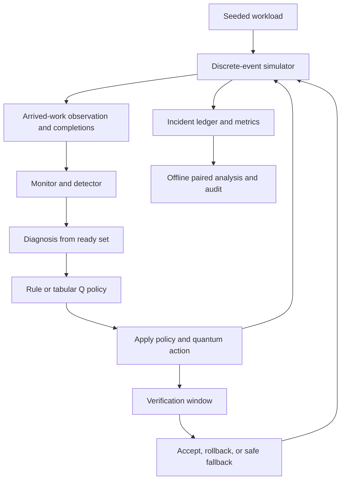
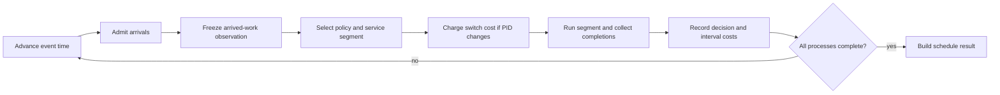
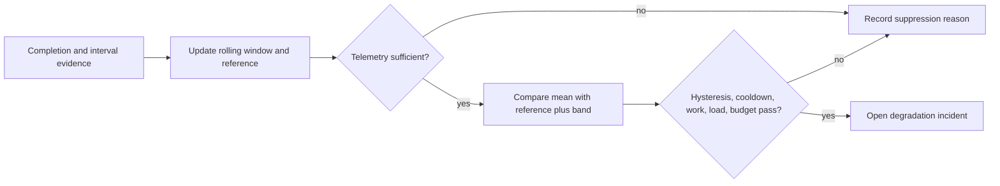
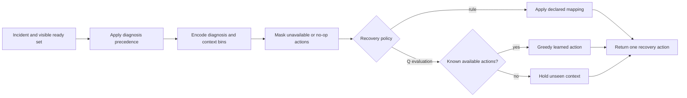
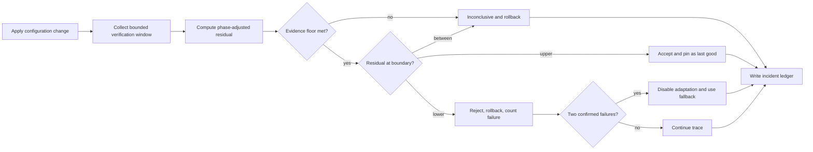
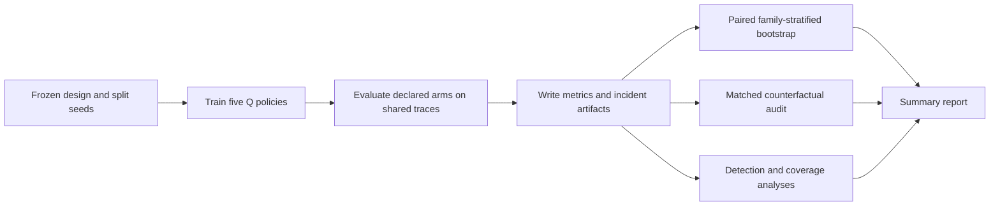

# Adaptive CPU Scheduling Using Reinforcement Learning for Dynamic Workloads

## Operating Systems Project Report

Final implementation, reproducibility, live demonstration and evaluation report

Prepared 23 October 2026

Repository: lostpilot404/OS-Project

Project scope: Self-healing CPU scheduling in a discrete-event simulator

This final report describes the primary self-healing system on branch `arena/49fb0ff9-os-project`, starting at `fd8f103`. It retains the nine requested academic sections and adds installation, live demonstration and verification. The supplied reference `OS(2).pdf` was not accessible in this checkout; no claim is made to have inspected it. The existing assessment report supplies the structural starting point. Course and student identifiers were not provided. Frozen research artifacts are reused, not regenerated or retuned. Fresh demonstrations and software checks are labelled separately.

## Abstract

This project implements and evaluates a self-healing CPU scheduler in a reproducible, single-CPU discrete-event simulator. The system monitors waiting times revealed by completed processes, detects degradation against a trace-specific reference, diagnoses a likely cause from the arrived ready set, chooses a recovery action using either a predeclared rule or tabular Q-learning, and verifies the change before keeping it. Rejected or inconclusive changes are rolled back; repeated confirmed failures disable further adaptation for that trace. The controller cannot inspect future arrivals, the complete workload object, completed schedules, or counterfactual outcomes.

The frozen primary experiment evaluates seven synthetic workload families, 210 held-out traces per arm, and final-test seed 23819. Mean waiting time is 122.39 simulated time units for the waiting-time rule and 122.56 for learned recovery, compared with 130.84 for the detection-only control and 94.66 for fixed shortest-job-first (SJF). Paired bootstrap estimates show that both recovery methods improve on the no-action control, that learned recovery is not distinguishable from the hand-written rule at the reported interval, and that neither matches fixed SJF. These findings are conditional on the declared synthetic workload design. Limited verification power, detector false triggers, sparse state-action coverage, and absence of real-kernel evaluation constrain the conclusions.

## 1. Detailed methodology of the proposed system

### 1.1 Problem statement and research questions

A fixed scheduler can become poorly matched to a changing mix of jobs. This project asks whether an online controller can identify degraded realized performance and change one scheduler configuration using only evidence available at the time. The research questions are:

1. Can degradation be detected from completed-work telemetry and current arrived-work observations, without exposing the workload's future?
2. Does recovery improve mean waiting time over a controller that runs the same detection logic but never intervenes?
3. Can recovery attain the performance of fixed SJF on the tested synthetic workloads?
4. Does tabular Q-learning improve on a predeclared diagnosis-to-action rule?
5. Can a bounded online verification window distinguish a helpful change from a harmful one or insufficient evidence?

The study is an experiment in simulated scheduling and recovery, not a kernel implementation. The principal response variable is mean process waiting time, measured in simulated time units.

### 1.2 Scope and simulator assumptions

The simulator models one CPU and a single persistent FIFO ready queue. FCFS and Round Robin (RR) select the queue head; SJF selects the shortest remaining burst; Priority selects the configured highest priority. SJF and Priority ties preserve queue order. FCFS, SJF, and Priority run non-preemptively; RR runs for the smaller of the quantum and remaining burst. A context-switch cost of one simulated time unit is charged when the running process changes. The baseline RR quantum is four time units.

Burst lengths of processes are assumed known once those processes arrive. This permits SJF selection, but is not a realistic guarantee of a general operating system. The model excludes multicore execution, I/O, interrupts, paging, deadlines, kernel overhead beyond the declared switch cost, and hardware timing. No real machine or operating-system kernel was modified or measured.

### 1.3 Causal control loop

For each trace, the simulator privately owns the complete event queue and advances time. At decision epochs it exposes an immutable observation of arrived, unfinished work and interval completion notices. The controller's lifecycle is:

1. Generate a deterministic workload from a family and derived seed.
2. Simulate the schedule under the active policy and collect completed-process waiting times.
3. Update a rolling performance monitor and its stable reference and dispersion band.
4. Detect degradation only when threshold, hysteresis, cooldown, work, queue, and intervention-budget conditions permit.
5. Diagnose the event from observable ready-set evidence.
6. Select an available recovery action by a declared rule or the learned policy.
7. Apply a policy and/or RR-quantum configuration change to the evolving queue.
8. Observe a bounded verification window and assign a verdict.
9. Keep an accepted change, roll back a rejected or inconclusive change, or disable adaptation after repeated confirmed failures.
10. Record the decision, evidence, cost, reward, and outcome in the incident ledger.

The monitor's detection statistic is the mean waiting time of up to the most recent eight completions; at least four completions are required before the detector evaluates it. The implementation maintains an exponentially smoothed reference and dispersion band. A window is suspect when its mean exceeds the reference plus 1.25 band widths. Two consecutive suspect evaluations are required. Detection is gated by a cooldown of three decision epochs, at least two ready processes, total visible remaining CPU work of at least 1.5 times the mean burst of arrived work, and a current queue-load level no lower than the trace's reference when that reference is defined. At most six interventions are allowed per trace. Reference updates are withheld during suspect periods and open incidents, avoiding immediate absorption of an ongoing degradation into the baseline.

The monitor also tracks waiting-time accrual per unit of simulated time. This rate corresponds to the mean number of processes waiting in the ready queue during the interval. It supplies verification evidence that reacts to queue drainage without requiring an already-completed cohort's waiting times to represent a post-intervention effect.

### 1.4 Observation contract and state encoding

The live controller sees the current simulated time, arrived and unfinished ready processes, their arrival times, remaining burst estimates and priorities, arrival/completion counters, observed aggregates, and the preceding policy. It also receives realized completion notices. It does not receive unarrived jobs, future events, the `Workload` object, final schedule metrics, or audit replay outcomes. Source-level tests exercise this causal boundary.

For Q-learning, `HealingContextEncoder` discretizes five incident features: six diagnosis categories; three bins for excess above the trigger threshold; three ready-queue-size bins; four current-policy values; and three visible-remaining-work bins. The product is 6 × 3 × 3 × 4 × 3 = 648 states. Eight recovery actions yield 5,184 nominal state-action entries. For bins (b1,b2,b3,b4,b5), the integer index is ((((b1 * 3 + b2) * 3 + b3) * 4 + b4) * 3 + b5). Thus [1,2,2,0,1] becomes state 205; a state index is a compact representation, not a process identifier.

### 1.5 Recovery actions and decision policies

The action space consists of holding the current configuration, setting FCFS, SJF, RR, or Priority, shrinking or growing the RR quantum, and reverting to the last accepted configuration. Actions that cannot change the live configuration are masked before selection. A request that results in no change is not counted as an intervention.

Two predeclared rules and the learned policy are evaluated. The waiting-time rule maps diagnoses to actions with the intent of lowering waiting time. The fairness-oriented rule is included as a predeclared comparison, not as a recommended design. The Q-learning policy uses epsilon-greedy training and a tabular value function; during evaluation it is deterministic, read-only, and selects only previously visited available actions. An unseen context results in a safe hold rather than an unsubstantiated choice. The fixed baselines are standalone FCFS, SJF, RR, and Priority. The `detector_only` arm executes the full monitor, detection, and diagnosis machinery but never changes the configuration.

The Q-learning update is:

Q(s,a) ← Q(s,a) + α [r + γ max over a′ Q(s′,a′) − Q(s,a)]

Here, s is the encoded incident context, a is the selected action, r is the verification-based reward, s′ is the post-window observed successor context (retaining the incident diagnosis), and a′ ranges over actions previously visited in s′. The live action-availability mask is enforced when selecting an action; the healing update passes only the visited-action mask to the shared learner, not a fresh configuration mask. A terminal update has no bootstrap term. This distinction is a current limitation, not a stronger masking guarantee. The frozen configuration uses learning rate α = 0.10 and discount factor γ = 1.00. Epsilon starts at 1.00, decays by 0.997 per episode, and has floor 0.05. Values start at zero. The undiscounted discount setting reflects the study's trace-level episodic recovery decisions; it does not represent a claim about a continuing production system.

### 1.6 Verification and reward

The verifier uses a normalized queue-load closure statistic:

closure = (trigger_load − post_load) / max(trigger_load − reference_load, load_band)

The variables `trigger_load`, `post_load`, and `reference_load` are observed queue waiting-accrual rates at the incident, after the verification window, and at the trace's stable reference, respectively. `load_band` is the observed dispersion floor. Closure is a dimensionless fraction in the scale defined by that denominator.

A phase-aware baseline predicts the no-action post-window queue load from quantities visible at the trigger: trigger load, ready count, and log(1 + visible remaining work). The prediction is converted to the closure scale. The verifier's residual is:

residual = observed_closure − expected_closure_for_trigger_phase

An intervention is accepted when residual is at least +0.30, rejected when residual is at most −0.30, and otherwise inconclusive. These boundaries were derived from the no-action control on the training split, not from the final test. A verdict is not issued when the window is truncated, has no positive duration, or has fewer than three completions. A verification window is evaluated over five decision epochs and three completions, with an upper decision cap of fourteen.

Accepted changes become the last accepted configuration and reset the confirmed-failure counter. Rejected changes are rolled back and count as confirmed failures. Inconclusive changes are also rolled back under the frozen safety posture, but do not count as failures and do not trigger the safe fallback. Two consecutive confirmed failures disable adaptation and pin the last accepted configuration, or the configured fallback if none exists.

For learning, the reward is the same phase-adjusted residual less the accept boundary and intervention cost. A confirmed rejection also incurs the declared rollback penalty. The intervention cost is 1% of reference waiting time and rollback penalty is 2%, each converted to band units by the implementation. Inconclusive evidence does not incur the confirmed-failure penalty. A hold is scored on the same statistic without an intervention cost. Thus the learned policy cannot gain reward from information unavailable to the verifier.

### 1.7 Experimental controls and evidence separation

All methods are evaluated on identical workload instances within each split. Workload seeds are derived by a stable SHA-256 procedure from master seed, split tag, family index, and repetition; fingerprints are used to check pairing and split disjointness. The final-test seed is frozen at 23819. Earlier examined streams are explicitly retired in the study configuration and are not reused as final evidence.

Threshold derivation and model training use training data. Validation supports development decisions and the illustrative demonstration. The held-out test reports the frozen comparison. Counterfactual replay is offline analysis performed only after the simulation. It reruns the controller on the same trace with a selected intervention forced to hold while preserving its preceding prefix and subsequent normal decisions. This replay estimates the intervention's marginal effect; the live controller never sees the counterfactual result.

## 2. Overall conceptual, architectural, and pipeline diagram

The architecture separates the environment that owns future events from the causal controller and the offline evidence pipeline. The following Mermaid source is intentionally printed as source text; no rendered diagram is included.



`workload/` produces reproducible process sets. `scheduler/runtime.py` owns arrivals, the queue, and service. It returns observations and execution records to `healing/`, which monitors and controls configuration. `experiments/healing_experiment.py` trains policies, evaluates arms, writes structured artifacts, and invokes offline audits and paired comparisons. `evaluation/` defines metrics and uncertainty calculations. `visualization/` is used by the experiment's optional figures, but figures are not embedded in this report.

## 3. Description of the major modules

### 3.1 Workload model and generation

`workload/models.py` defines processes, workload containers, fingerprints, outcomes, and validated schedule results. `workload/generator.py` samples arrivals, bursts, and priorities from declared family configurations using NumPy's seeded generator. `workload/fingerprint.py` supports identity checks across arms and split integrity tests.

### 3.2 Event-driven simulator and baseline schedulers

`scheduler/runtime.py` advances the single-CPU event queue, maintains the FIFO ready queue, constructs causal `RuntimeObservation` objects, executes the chosen service segment, charges switching cost, and records decisions. `scheduler/fcfs.py`, `scheduler/sjf.py`, `scheduler/round_robin.py`, and `scheduler/priority.py` provide fixed comparison policies. `scheduler/base.py` contains shared timeline and schedule-result support.

### 3.3 Monitoring and degradation detection

`healing/monitor.py` maintains completed-work waiting-time windows, reference and dispersion estimates, and queue waiting-accrual statistics. `healing/detector.py` applies the threshold, hysteresis, cooldown, work and load gates, and intervention cap. Suppression reasons are retained rather than silently discarded.

### 3.4 Diagnosis and recovery actions

`healing/diagnosis.py` derives a primary diagnosis from visible ready-set evidence using a fixed precedence. Categories include head-of-line blocking, fairness starvation, priority-ordering anomaly, tail dispersion, queue congestion, and unexplained. `healing/actions.py` defines the eight actions and configuration changes. `healing/policies.py` implements hold-only, diagnosis-to-action rules, state encoding, and the learned recovery policy.

### 3.5 Verification and controller state machine

`healing/verifier.py` computes phase-adjusted residuals, tri-state intervention outcomes, and evidence-floor checks. `healing/controller.py` coordinates monitoring, detection, diagnosis, selection, application, verification, reward assignment, rollback, safe fallback, and incident logging. It also provides replay support used by post-run analysis.

### 3.6 Experiment and analysis pipeline

`experiments/healing_config.py` declares the primary study's arms, seeds, split sizes, Q-learning settings, and healing thresholds. `experiments/healing_experiment.py` trains five independent learned policies, evaluates all arms, writes training/evaluation ledgers and summaries, and runs audits. `experiments/healing_detection.py` probes controlled degradation scenarios; `experiments/healing_thresholds.py` records control-based threshold derivation. `evaluation/metrics.py` calculates schedule metrics, while `evaluation/paired.py` performs family-stratified crossed bootstrap comparisons.

### 3.7 Command-line entry point and preserved workflows

`main.py` defaults to `healing-study`, the primary system described in this report. The explicit `demo` command runs short real self-healing rule fixtures in a separate output directory. It also retains `study`, `runtime-experiment`, and legacy `experiment` and `train` commands for separate workflows. Their experiment designs and artifacts are independent. In particular, the runtime policy-switching experiment has four scheduler-policy actions and its own 162-state encoder, with final-test seed 19301. Those settings and outcomes are not inputs to, and are not combined with, the primary self-healing study's seed 23819, 648-state encoder, eight-action recovery space, or evaluation results.

## 4. Workflow diagram for each major module

The following Mermaid blocks are source code for the module workflows. They use nodes and relationships from the checked-out implementation. They are not rendered in the PDF.

### 4.1 Workload generation and split integrity

This workflow constructs one synthetic process set, assigns a reproducible identity, and keeps split streams separate.


The family configuration determines generation distributions. Seed derivation makes each family/repetition deterministic, while fingerprints allow the experiment harness and tests to verify that methods are compared on the same trace and that splits do not overlap.

### 4.2 Scheduling runtime and causal interface

The simulator privately advances arrivals and service, but emits only current observation data and completed interval evidence to its controller.



The event engine retains queue order and remaining bursts across policy changes. Non-RR service runs to completion; RR service runs at most one quantum. Decision records include realized waiting-cost increments and completion notices, which become causal inputs to the healing controller.

### 4.3 Monitoring and degradation detection

The monitor updates evidence from completed work and queue-load intervals; the detector applies explicit gates before opening an incident.



The detector requires the declared 1.25-band threshold and two suspect evaluations. Cooldown, minimum ready work, minimum load, and the per-trace intervention budget prevent every transient increase from triggering a recovery. These controls reduce uncontrolled repeated action but do not eliminate false triggers, as the validation scenarios demonstrate.

### 4.4 Diagnosis and action selection

A diagnosis and encoded context are formed from current ready-set evidence before the policy selects among actions that can change the configuration.



Rules and Q-learning receive the same causal context. Masking prevents meaningless requests, and the Q controller does not pretend an unvisited state-action estimate is learned. Diagnosis is an operational label for observable evidence, not a claim that the simulator identifies a real kernel pathology.

### 4.5 Verification, settlement, and incident recording

An applied change is evaluated only over later online observations; only after settlement is its counterfactual replay available to the analysis process.



The settlement step distinguishes harmful evidence from uncertainty. Rejection counts toward fallback; inconclusive rollback does not. The incident ledger records the causal window and verdict. The audit later replays selected incidents offline and is not on the runtime control path.

### 4.6 Experiment, metrics, and post-run audit

The harness separates training, validation, and final evaluation, then creates paired summaries and post-run evidence from saved events.



The final comparison is paired by workload identity. Audits and controlled detection probes characterize different questions from the headline arm comparison, so their denominators and split provenance are stated separately in the results.

## 5. Dataset details and data collection procedure

### 5.1 Synthetic workload families

Each generated workload contains 15 processes. Every process has an integer arrival time, burst length, priority, and stable process identifier. The project defines seven families:

- `short_jobs` uses bimodal burst lengths from 1 to 50 time units, with an 80% chance of drawing from the short 1–5 range; arrivals are uniform over a 20-unit window.
- `long_jobs` uses the same burst bounds and arrival pattern, with a 20% chance of a short 1–5 burst and the remaining draws from the longer mode.
- `mixed` draws bursts uniformly from 1–50 with arrivals uniform over a 20-unit window.
- `cpu_bursty` draws bursts uniformly from 20–50 with arrivals over a 15-unit window.
- `priority_skewed` draws bursts uniformly from 1–50 and uses uniform arrivals over 20 units; 70% of priorities are drawn from the high-priority band 1–2.
- `staggered_interactive` begins with one 25–50-unit job and follows it with 14 short jobs of at most 3 units, at arrival gaps uniformly drawn from 4–6 units; all priorities are equal.
- `poisson_arrivals` draws bursts uniformly from 1–20 and generates arrivals from a Poisson process with rate 0.5 per time unit. This family is excluded from Q-policy training and serves as the declared held-out family condition.

All of these are synthetic distributions. No external trace corpus is included in the primary study.

### 5.2 Splits, repetitions, and seed derivation

The five Q-learning training seeds are 7101, 7102, 7103, 7104, and 7105. Each learned policy trains for 1,200 traces cycling through the six families other than `poisson_arrivals`, for 6,000 training traces across the five independent models.

Validation uses master seed 8201 and 20 repetitions in each of seven families, for 140 traces. It supports development and a worked demonstration, not the reported final comparison.

The frozen final test uses seed 23819 and 30 repetitions per family, giving 210 distinct traces per arm. Every arm receives the same traces. Q-learning has five independently trained seeds, so the learned-arm summary includes 1,050 method-trace outcomes (five models times 210 shared traces); deterministic fixed arms and single rule arms each have 210 outcomes.

Workload seeds are derived with split-specific tags: training 51, validation 67, and final test 83, together with family and repetition indices. The generator's SHA-256-based seed derivation is deterministic. Repository tests assert reproducibility and disjoint workload fingerprints between splits. The final-test stream was declared in the current primary configuration before the frozen evaluation. Previously examined streams are retired and cannot be substituted as fresh evidence.

### 5.3 Collection process and artifact records

The experiment harness runs each trace through the simulator, computes final schedule metrics, and records the workload fingerprint and design coordinates. For healing arms it additionally writes episode outcomes, incident evidence, offered and selected actions, verification window details, reward, rollback target, and fallback status. The experiment writes CSV and JSON files beneath `results/healing/`; key evidence includes `healing_metrics_final_test.csv`, `healing_incidents_final_test.csv`, `healing_episodes_final_test.csv`, `healing_comparisons.csv`, `healing_audit.csv`, `healing_coverage.csv`, `healing_training_episodes.csv`, and `healing_summary.json`.

The final-test metrics file contains 3,780 rows across the fixed, rule, control, and learned arms. The final-test incident file contains 2,171 rows across all recorded control and recovery incidents. The audit file contains 3,256 intervention rows over both validation and final test. These are artifact row counts, not counts of independent workloads. For example, a Q policy is evaluated on the same 210 workloads for each of its five training seeds.

### 5.4 Data integrity and scope

The control and recovery arms are paired on workload fingerprints. Training, validation, and final test use disjoint derived streams. Controlled detector scenarios use the validation traces only: stable traces, a four-fold burst shock for arrivals after the injection time, and an arrival storm that compresses later arrivals by a factor of 0.35. Those probes are diagnostic, not extra final-test comparisons.

The counterfactual audit is run after live simulation. A matched replay forces one previously selected intervention to hold, verifies that the execution prefix remains identical up to that decision, and applies later controller decisions as usual. It estimates intervention effects against the no-change alternative for analysis only. No audited values enter the live Q controller or the held-out selection process.

## 6. Tools, technologies, algorithms, and frameworks used

### 6.1 Implementation technologies

- Python 3.11.2 is the implementation language and the version recorded for the committed experiment environment.
- NumPy 2.4.6 supplies seeded random-number generation and numerical operations.
- pandas 3.0.6 supports experiment ledgers, metric aggregation, and CSV/JSON artifact generation.
- Matplotlib 3.11.2 supports optional plots produced by the experiment tooling; no plot is used as a figure in this text-only report.
- pytest 9.1.1 is the automated test framework.
- `requirements.lock` records the resolved Python dependencies used for the experiment. `requirements-report.txt` also lists report-generation dependencies.

### 6.2 Algorithms and evaluation procedures

The runtime is a deterministic discrete-event simulation. Four fixed schedulers provide reference policies: FCFS, SJF, RR, and Priority. Monitoring uses rolling completion windows with exponentially smoothed reference and band estimates. Detection combines a threshold, hysteresis, cooldown, workload/load gates, and intervention cap. Diagnosis uses fixed precedence on observable ready-set features. Recovery uses either declared rules or tabular, epsilon-greedy Q-learning with action masking. Verification uses phase-adjusted queue-load closure and control-derived residual boundaries. Paired uncertainty is estimated with a 1,000-replicate, family-stratified crossed bootstrap, using bootstrap seed 104729.

The scheduler metrics are computed from completed schedules. Per-process waiting time is total time in the ready queue across all preemptions, equivalently completion time minus arrival time minus CPU burst. Turnaround time is completion time minus arrival time. Response time is the time from arrival to first service. CPU utilization is busy CPU time divided by elapsed simulated time, expressed as a percentage. Throughput is completed processes per simulated time unit. Context switches count changes of running process. The main reported statistic is the arithmetic mean of process-level waiting times, averaged over the designated traces; p95 waiting time is a separate tail statistic. The primary study uses the nearest-rank p95: sort the n process waits and select rank ceil(0.95*n). With n = 15 this equals the maximum wait, explaining why the stored p95 and max coincide. These values are simulated-time quantities, not wall-clock timings.

## 7. Experimental plan and evaluation metrics

### 7.1 Comparison arms

The frozen experiment contains four fixed baselines, a detection-only control, two recovery rules, five independently trained Q-recovery models, and two SJF-start safety checks. `fixed_fcfs`, `fixed_sjf`, `fixed_round_robin`, and `fixed_priority` run the untouched standalone policies. `detector_only` runs the full causal monitor/detector loop but holds rather than intervening. `rule_wait` and `rule_fairness` start from FCFS. `q_recovery` aggregates five trained models, each started from FCFS. `rule_wait_from_sjf` and `q_recovery_from_sjf` test whether adaptation damages a strong starting policy.

The principal comparisons, defined before final evaluation, address recovery against the detector-only control and fixed FCFS, recovery against fixed SJF, and Q-learning against the waiting-time rule. Detection recall, stability false-trigger frequency, verification discrimination, action-effect probes, and state-action coverage are reported separately because they measure distinct components and use different denominators.

### 7.2 Statistical procedure

All arms are compared on matched traces. The paired differences are resampled within each family, with independent resampling of learned-model seeds and workload repetitions. The implementation uses 1,000 bootstrap replicates and seed 104729; reported intervals are 95% percentile intervals. An interval describes uncertainty conditional on these five model seeds, seven synthetic families, fixed repetition counts, and the observed seed design. It does not establish a result for all workloads or real operating systems.

For a pair, the signed difference is target minus reference in mean waiting time. Negative values favor the target because lower waiting time is better. Results below use simulated time units and the stored primary artifacts, rather than values from the separate runtime experiment.

### 7.3 Frozen final-test results

On 210 traces, mean waiting time was 130.84 for fixed FCFS and for the equivalent detection-only control. Fixed SJF achieved 94.66. Fixed RR had mean waiting time 217.05, and fixed Priority 128.32.

The predeclared waiting-time recovery rule achieved mean waiting time 122.39. Against `detector_only`, its paired mean difference was −8.45 units, with 95% interval [−9.44, −7.35]. Against fixed SJF, it was +27.73 units, with interval [+26.05, +29.72]. Thus the rule improves on doing nothing but remains worse than SJF on this experiment.

The learned recovery arm achieved mean waiting time 122.56 across its five models and 210 shared traces per model. Against `detector_only`, the paired difference was −8.27 units, with interval [−9.33, −7.23]. Against fixed SJF, the difference was +27.91, with interval [+26.11, +29.87]. Against `rule_wait`, the difference was +0.18, with interval [−0.04, +0.48]. This interval includes zero; these results do not show that Q-learning beats the predeclared waiting-time rule.

The fairness-oriented rule had mean waiting time 136.78, worse than FCFS. Its matched counterfactual audit reports a mean gain of −130.84 waiting-time units per intervention and a false-recovery share of 76.7% (115 of 150 audited interventions had non-positive gain). This is a negative result, not a recommended policy.

Starting from SJF, `q_recovery_from_sjf` reproduced SJF to numerical precision, with no interventions and a paired waiting-time difference of zero. `rule_wait_from_sjf` had a small mean difference of +0.21 units versus fixed SJF, with interval [+0.04, +0.43]. The no-intervention result for learned recovery is consistent with available-action masking and the learner's choice to hold when the state has no evidence for an available action.

For the headline rule comparison, p95 waiting time was 258.42 for FCFS/control, 251.88 for `rule_wait`, and 249.20 for fixed SJF. This tail statistic is not the same as the mean and shows a smaller improvement under recovery than the mean waiting-time change.

### 7.4 Verification and counterfactual findings

In the final-test intervention audit, `rule_wait` had 141 interventions. Matched replay indicated that 133 helped and 3 were harmful; the mean matched gain was +188.79 waiting-time units per intervention. The audit's remaining cases included zero-effect interventions. For `q_recovery`, 678 interventions were audited: 644 helped, 17 were harmful, and the mean matched gain was +192.07 units per intervention. These are offline replay results, not online controller observations.

The verifier accepted 65 interventions in the pooled evaluation set; all 65 were helpful in the matched audit. However, only 54 of 812 helpful interventions cleared the unconditional closure null 95th percentile, about 6.7%. This historical unconditional boundary is not the operative phase-aware rule. With the operative +0.30 residual boundary, 65 of 812 (about 8.0%) were certifiable. These denominators belong to the pooled matched final-test audit, not the validation action probe. The result shows conservative false-certification behavior coupled with weak ability to certify ordinary improvements. Across the final-test intervention population, the harmful share was 136 of 973, about 14.0%; 26 of 34 rejected interventions were harmful, 76.5%. Rejection is not a complete detector of harm, and acceptance does not imply that an action was globally optimal.

The matched counterfactual audit does not invalidate the online verifier: the audit has access to an alternate run of the same trace, while the online controller cannot. It is a measurement tool for judging the verifier, not an implementable live signal under this design.

### 7.5 Detector findings

On the validation split, controlled degradation detection identified 75.0% of the burst-shock traces and 56.4% of the arrival-storm traces. The median detection delay across injected scenarios was six decision intervals, or 113.5 simulated time units. The median delay was 134.0 units for burst shock and 81.0 units for the arrival storm. The stable-scenario false-trigger frequency was 0.70 incidents per trace, and 68.6% of stable traces triggered at least once. The project calls the combined detection proportion a precision proxy, not precision, because injection status is not ground truth for the detector's target event. Raising the minimum-load gate to 1.25 lowered stable triggers to 0.042 per trace but also missed nearly all injected changes. The declared threshold was selected using training evidence; the validation measurements describe its behavior.

### 7.6 Q-learning coverage

Each learned recovery model trained on 1,200 traces, with 745–772 detected training incidents across the five seeds. The nominal state-action space contains 648 × 8 = 5,184 entries. The stored coverage artifact reports 56–66 visited state-action pairs per training seed, or about 1.1–1.3% of the nominal table and 3.8–7.2% of the state-action pairs estimated reachable from the contexts observed in training. Visits are concentrated in a small subset of states. Only four or five actions were exercised depending on the seed; several configured actions are masked as ineffective from the FCFS starting state. Coverage increased little after roughly 900 episodes. Sparse event supply and state-action coverage limit claims about what the learned table has learned.

### 7.7 Interpretation

The supported conclusion is specific: under the declared synthetic traces and simulator assumptions, the waiting-time rule and tabular Q-learning both improve mean waiting over the detection-only FCFS control; Q-learning does not outperform the rule within the estimated interval; and neither recovery strategy reaches fixed SJF. The fairness-oriented mapping is detrimental. The evidence supports implementing and auditing a causal recovery loop, not a claim that reinforcement learning is superior, that every intervention can be certified, or that the same result would hold on a real operating system.

## 8. Implementation progress and valid outputs

### 8.1 Completed implementation components

1. **Workload generation.** `workload/` implements seven seeded synthetic families, process validation, and content fingerprints. `tests/test_generator.py`, `tests/test_workload_models.py`, and `tests/test_fingerprint.py` cover generation and identity behavior.
2. **Scheduling runtime and baselines.** `scheduler/runtime.py` implements a causal observation boundary, persistent FIFO ready queue, service, event handling, and execution records. Four fixed schedulers are available under `scheduler/`. Runtime scheduler tests compare constant-policy execution with the standalone policies and validate queue and observation rules.
3. **Monitor and detector.** `healing/monitor.py` and `healing/detector.py` implement the rolling evidence, thresholds, hysteresis, gating, and suppression reasons. Unit tests cover detection, telemetry, cooldown, sustained degradation, and verification-window behavior.
4. **Diagnosis and actions.** `healing/diagnosis.py` and `healing/actions.py` implement fixed-precedence evidence labels and the eight action space, including no-op detection and quantum bounds. Dedicated diagnosis and policy/action tests are present.
5. **Recovery policy implementations.** `healing/policies.py` implements the hold control, rules, context encoding, and Q-learning policy. `rl/q_learning.py` implements the tabular learner and exploration schedule. Tests cover action masking, reproducible learning, and state encoding.
6. **Verification, rollback, and fallback.** `healing/verifier.py` and `healing/controller.py` implement accepted, rejected, inconclusive, and held outcomes, rollback, confirmed-failure counting, and safe fallback. Corresponding controller and verification tests exercise the state transitions.
7. **Evaluation artifacts.** `experiments/healing_experiment.py`, `experiments/healing_detection.py`, and `evaluation/` generate comparison metrics, ledgers, bootstrap intervals, audit data, threshold probes, and Q coverage outputs. Machine-readable artifacts are committed under `results/healing/`.
8. **CLI and reproducibility configuration.** `main.py`, `experiments/healing_config.py`, `requirements.lock`, and tests for experiment design expose the primary study and preserve the frozen seeds and settings.

These components are implemented, tested in the repository, and represented by committed result artifacts. This does not imply that the research limitations in Section 9 have been solved.

### 8.2 Valid outputs and provenance

The frozen study summary identifies 210 final-test workloads, five independent Q training seeds, validation seed 8201, and final-test seed 23819. It stores final arm means, bootstrap comparisons, detector summaries, coverage measurements, and verification discrimination in `results/healing/healing_summary.json`. Per-trace records and incident ledgers retain the underlying outcomes. The separate `results/runtime/` and `results/study/` directories contain preserved studies with their own designs and seed streams; they are not pooled with the primary healing evidence.

During finalization on Debian 12 Linux x86-64 with Python 3.11.2, `.venv/bin/python -m pytest -q` completed with 500 passed and one existing plotting warning in 38.37 seconds. Five new demo tests are included. The focused demo suite passed in 0.69 seconds. These are actual software checks, not a rerun of the frozen research experiment. Historical 495-pass evidence belongs to earlier work, not this execution. WSL itself was not available for execution.

### 8.3 Demonstration trace

The committed validation demonstration is `results/healing/healing_demo.json`. It records one `long_jobs` validation trace, selected by an explicit validation-only demonstration rule, and its decision history. The demonstration is illustrative and is not a substitute for the held-out aggregate. It is not necessary to infer a new result from the demonstration when the study already stores paired final-test summaries.

### 8.4 Executable quick demonstration

`python main.py demo` now executes `experiments/demo.py`, which reuses the real workload generator, default healing configuration, RuntimeSimulator, SelfHealingController, HealingContextEncoder, waiting-time rule and metric implementation. No scheduler imitation, hard-coded verdict, fitted Q table or saved trace is used. The quick command deliberately uses the predeclared rule so that a lecturer can inspect an incident without waiting for five-model training. It demonstrates the primary control system, not a claim of learned behavior. The original validation-selected learned trace remains available in the separate committed artifact discussed in Section 8.3.

Two illustrative `mixed` generator seeds, 3 and 13, supply 15 processes each. Their selection is presentation-oriented and is not a random sample for estimating performance. No final-test data were used to choose them, and the study thresholds were not altered or tuned. Every run prints the complete small process set, arrived-ready PIDs at each decision, selected scheduling policy, executed PID and interval, switch delay, waiting accrual, incident diagnosis, state bins, available actions, verification verdict and final measurements. Full observations include arrived remaining bursts and priorities in the JSON.

On the actual Debian/Python 3.11.2 run, seed 3 triggers at decision 6, time 141. The recent mean completed waiting is 51.000 against threshold 28.203. The diagnosis is fairness starvation. Bins [1, 2, 2, 0, 1] encode state 205. The waiting-time rule selects SJF. Its residual 0.205922 is within the null range: the verdict is inconclusive, and FCFS is restored at the first epoch at or after window end time 193. It is not a confirmed failure. Mean waiting is 130.467 versus 150.600 for a separately run FCFS schedule on the same input.

Seed 13 triggers at decision 6, time 243, with completed-window mean 105.167 versus threshold 75.703, the same state bins and SJF action. The residual 0.437455 exceeds +0.30; the verdict is accepted at time 319 and the configuration is retained. Mean waiting is 220.533 versus FCFS 255.800. These two fixtures do not produce rejected verdicts. That branch and safe fallback are exercised by controller tests, not fabricated for the demonstration.

The first mean-wait difference is -20.133 and the second is -35.267 simulated units. They are not the frozen study's aggregate improvements and do not establish a general advantage. Even an inconclusive action can reduce final waiting: certification is a bounded online evidence decision, not access to the true counterfactual. The demo prints a reward for auditability, but the rule does not update any Q values.

`results/demo/demo.json` contains input processes, full causal observations, decisions and service segments, per-process outcomes, complete incident rows, encoded feature bins, rule and separately measured FCFS metrics, and default configuration values. It is disposable, gitignored and separate from frozen results. It contains no host-dependent wall timing, so repeated executions produce identical bytes. `--results-dir` accepts a new writable output path and creates nested directories. The transcript captured from the actual command is `docs/examples/demo_linux_output.txt`.

### 8.5 Installation, live presentation and verification status

The primary runtime target is WSL2 Ubuntu. Installation should keep the checkout under the Linux home directory, use the selected interpreter explicitly to create `.venv`, and install `requirements.lock`. Report packages are optional and listed in `requirements-report.txt`. The demo runs in a terminal without network after installation, GUI or web server. The documented full research commands use separate result directories to protect frozen artifacts.

No WSL environment was present. Installation dependencies, CLI checks, real demo, focused tests and the full 500-test suite were executed on Debian 12 Linux with Python 3.11.2. This is Linux compatibility evidence only; execution under Windows WSL2 and Ubuntu package installation remain unverified. Tests cover deterministic repeated JSON, metric arithmetic and waiting-accrual identity, visible-arrival boundaries, verdicts and rollback, output paths containing spaces, default outputs, an absolute entry point from a different working directory, CLI help/invalid commands and actionable file errors. The one full-suite warning is an existing empty-legend warning in the legacy-probe plotting rejection test.

`docs/DEMO_SCRIPT_FOR_LECTURER.md` supplies a five-to-eight-minute speaking guide, source navigation, question answers, preflight and recovery instructions. `docs/FINALIZATION_AUDIT.md` records severity-ordered issues and fixes. `docs/FINAL_DELIVERY_CHECKS.md` records the final PDF and software verification. No current module was rewritten for style, no existing assertion weakened, and no final-test tuning was performed.

## 9. Challenges encountered and plan for remaining work

### 9.1 Verification has low certification power

The phase-adjusted verifier avoids many false certifications, and all 65 accepted interventions in the pooled matched audit helped. Nevertheless, only about 8.0% of helpful interventions clear the operative phase-aware acceptance boundary. The older unconditional null 95th-percentile boundary would certify about 6.7%. Most helpful changes end inconclusive and are rolled back. A single bounded window often contains too little evidence relative to variation in queue load. The audit can estimate the effect offline, but its same-trace no-action comparison is unavailable to a live controller.

### 9.2 Detection has a false-trigger trade-off

The validation control triggers on 68.6% of stable traces at the declared load gate, with 0.70 incidents per stable trace. A stricter load gate substantially suppresses false triggers while also lowering recall for injected degradation. The present report preserves this trade-off instead of selecting a more favorable threshold on validation or final-test data.

### 9.3 The Q table is sparsely covered

A 648-state by eight-action table is large relative to the number of detected incidents in 1,200 training traces per seed. Coverage plateaus after approximately 900 episodes. Increasing the training budget alone is not shown to solve the event-supply problem, and the learned arm is statistically indistinguishable from the simpler waiting-time rule. A compact or factorized state representation and a better-supported action set are appropriate research directions, but are not implemented claims.

### 9.4 Workload and simulator validity are limited

The families are synthetic, contain 15 processes, and cover only seven distributions. The controller receives exact arrived burst lengths, and the system models a single CPU with simplified scheduling costs. It has not been tested on real traces, multicore scheduling, I/O-heavy workloads, kernel integration, or imperfect runtime burst estimates. Results therefore describe this model and seed design only.

### 9.5 Future work sequence

The next work should preserve the current held-out result and proceed in this order:

1. Improve verification sample efficiency using multiple windows, a trace-specific drain model, or another online-computable no-action reference. Evaluate candidate changes only on training and validation data before declaring a new final-test stream.
2. Characterize detector false-trigger and recall trade-offs on additional independently generated validation conditions. Retain both stable and injected cases and report denominators and delay units.
3. Reassess the state/action representation against the observed event supply. Prefer a reduced, causally observable state and eliminate actions that cannot change the configuration from relevant starting conditions.
4. Add broader workload conditions and burst-estimation uncertainty, then test sensitivity to switching cost and RR quantum. These extensions should be separately versioned and evaluated.
5. Only after the simulator study is stable, consider a safe kernel-facing prototype with explicit instrumentation and a separate ethical and systems validation plan. The current repository does not implement such integration.

## 10. Conclusion

The repository's primary project is a self-healing scheduling study, not the separate runtime policy-switching experiment preserved in the same codebase. In its frozen synthetic evaluation, a waiting-time recovery rule and a Q-learning recovery policy both reduce mean waiting relative to a detection-only control, but they do not match fixed SJF, and Q-learning does not demonstrate an advantage over the rule. Online verification is conservative and often inconclusive, detector false triggers remain material, and learned state-action coverage is sparse. The implementation makes those limits inspectable through causal runtime interfaces, explicit incident records, paired analysis, and offline counterfactual audits; it does not establish real-operating-system performance.

## Appendix A. Reproducibility commands and configuration

### A.1 Environment and report build

The recorded interpreter is Python 3.11.2. Ubuntu defaults must not be assumed equivalent. `docs/WSL_SETUP.md` provides exact system packages, a private CPython build, clone/branch instructions and virtual environment setup. After installing the selected interpreter, from the repository root:

```bash
"$HOME/.local/python-3.11.2/bin/python3.11" -m venv .venv
source .venv/bin/activate
python -m pip install -r requirements.lock
python -m pip check
python main.py --help
python main.py demo
python -m pytest -q tests/test_demo.py
python -m pytest -q
```

The private interpreter path is the Ubuntu installation described in the WSL guide; the tested Debian host instead used its existing `/usr/bin/python3.11` at version 3.11.2. The Python patch release is old and intended here for isolated local reproduction, not a network service. Report dependencies are installed separately:

```bash
sudo apt install -y fonts-dejavu-core
python -m pip install -r requirements-report.txt
python tools/build_plain_report.py \
  --source docs/OS_Project_Final_Report.md \
  --output docs/OS_Project_Final_Report.pdf
```

The Markdown is authoritative. The builder prints code and Mermaid source literally, embeds local fonts, numbers pages, and never runs experiments. It does not overwrite Review 2. No GUI, TeX, Pandoc or Mermaid renderer is needed. All report text is black on white, with no tables or images.

### A.2 Primary study reproduction

The primary study command is:

```text
python main.py healing-study \
  --results-dir /tmp/healing-results \
  --figures-dir /tmp/healing-figures
```

The separate output paths protect the committed frozen artifacts. Optional flags are `--no-figures` and `--no-probe`. A run using the default output paths can replace committed evidence and is therefore not used as part of this report task.

### A.3 Frozen primary configuration

The primary final-test seed is 23819, with 30 repetitions for each of seven families. Validation uses seed 8201 and 20 repetitions per family. Q-learning training seeds are 7101 through 7105, with 1,200 traces per seed across six families. Split tags are 51, 67, and 83 for training, validation, and final test. The paired bootstrap uses 1,000 replicates and seed 104729. The RR baseline quantum is four; switching cost is one simulated unit. The frozen final-test artifacts are under `results/healing/`.

### A.4 Distinction from preserved experiments

`main.py runtime-experiment` runs a runtime policy-switching study with an independent design, artifacts under `results/runtime/`, a 162-state encoder, four scheduler-policy actions, and final-test seed 19301. It selects among FCFS, SJF, RR, and Priority at runtime; it does not implement the primary study's diagnosis-triggered recovery, phase-aware intervention verification, or rollback lifecycle. `main.py study` runs an offline whole-workload selection workflow with artifacts under `results/study/`. The legacy commands `main.py experiment` and `main.py train` are also preserved. None of these secondary outputs is combined with the self-healing results reported above. The reference distinction mentioned in the assessment is therefore resolved by the checked-out source's explicit designation: `main.py` and `README.md` identify `healing-study` as primary, while the runtime experiment is explicitly an appendix/preserved workflow.

### A.5 Checkout and artifact provenance

The requested reference branch/commit was `arena/4a2c2384-os-project` at `ea30833`. The actual clean checkout started at `fd8f103d94f267844b3ac78256ab98e987306df0` on the fixed session branch `arena/49fb0ff9-os-project`. It was not reset or switched. The new final report supersedes stale branch/test/probe statements in the preserved earlier plain report without modifying that historical document.

The canonical validation action-effect probe contains 784 rows across 98 incidents, identified by workload fingerprint and decision index. Every incident is replayed with all eight recovery actions. `controller_reward` uses the shared `healing/reward.py` definition, including phase correction, acceptance offset and costs. `raw_load_improvement_band_units` is a separate exploratory proxy, not the controller reward; its historical alias must not be relabelled as the objective.

The separate `healing_action_probe.legacy_raw_proxy.csv` retains 168 rows across 21 incidents. It lacks the repaired reward schema and remains an archive, not canonical evidence. A default full-study CLI run generates a compact corrected-reward probe using four repetitions per family, whereas the committed canonical probe covers all validation incidents. Do not overwrite the canonical probe with that smaller output. The explicit canonical procedure is in `docs/ENGINEERING_COMPLETION_REPORT.md`.

Neither the full expensive study nor these probe artifacts was regenerated during this delivery or the previous reporting corrections. The frozen test stream 23819 is unchanged. Fresh small fixture results and test outcomes are separate software evidence. All tracked study and Review 2 artifacts were preserved byte-for-byte.

## Source files and evidence

The report's principal implementation references are `main.py`, `config.py`, `workload/generator.py`, `scheduler/runtime.py`, `healing/monitor.py`, `healing/detector.py`, `healing/diagnosis.py`, `healing/actions.py`, `healing/policies.py`, `healing/verifier.py`, `healing/controller.py`, `experiments/healing_config.py`, `experiments/healing_experiment.py`, `evaluation/metrics.py`, and `evaluation/paired.py`. Its numerical claims are based on `results/healing/healing_summary.json`, `results/healing/healing_metrics_final_test.csv`, `results/healing/healing_comparisons.csv`, `results/healing/healing_audit.csv`, and the related committed canonical artifacts.
