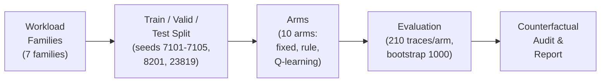
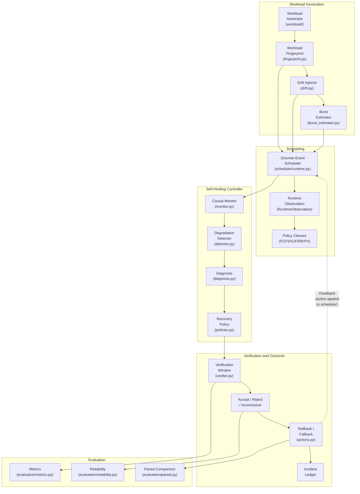
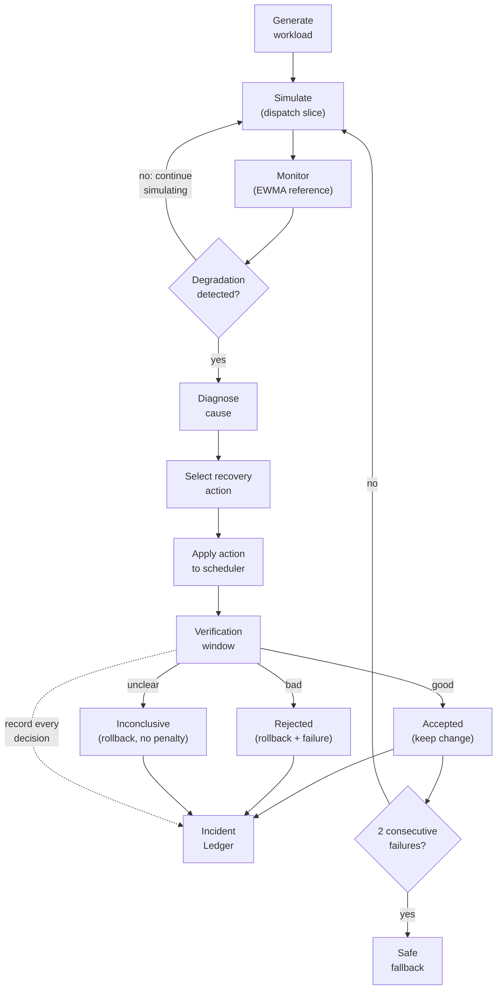
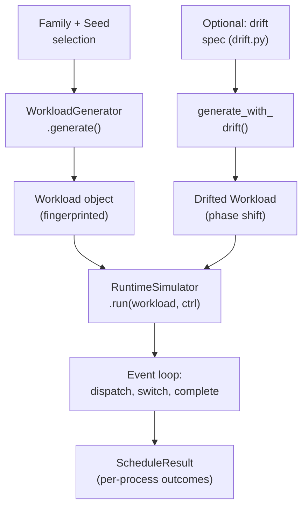
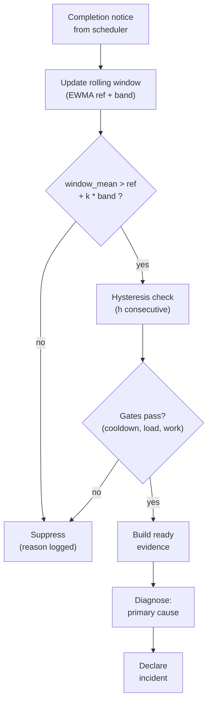
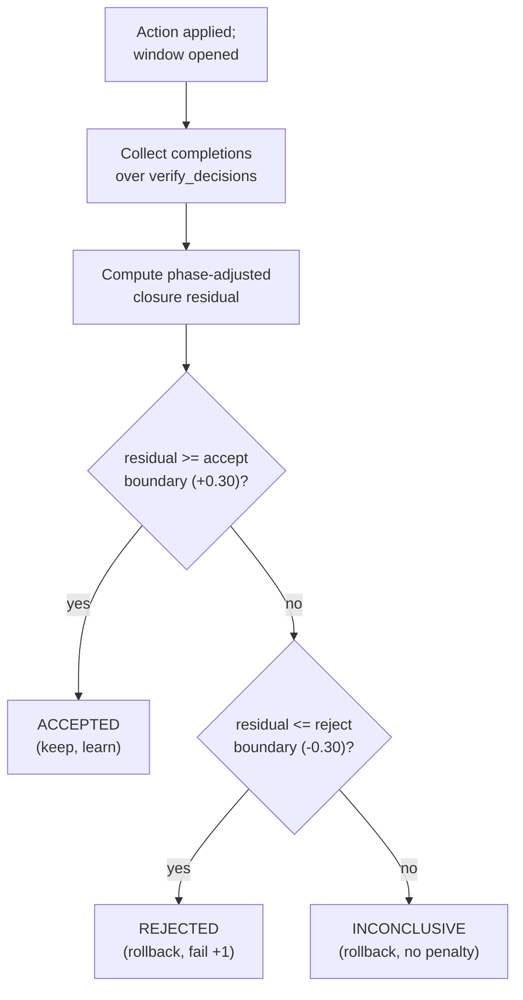
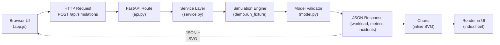

# Mermaid Source for Review 3 Figures

Copy any of these diagrams into [mermaid.live](https://mermaid.live) or a Markdown viewer
that supports Mermaid to render them. All diagrams use black-and-white styling.

---

## Figure 1. Experimental methodology pipeline

---

## Figure 2. Overall system architecture of the adaptive CPU scheduling pipeline

---

## Figure 3. Self-healing controller workflow (one trace)

---

## Figure 4. Workload generation and scheduling workflow

---

## Figure 5. Degradation detection and diagnosis workflow

---

## Figure 6. Verification, acceptance, and rollback workflow

---

## Figure 7. Frontend-to-backend simulation execution flow

