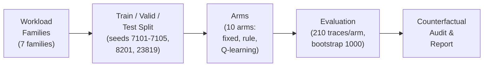
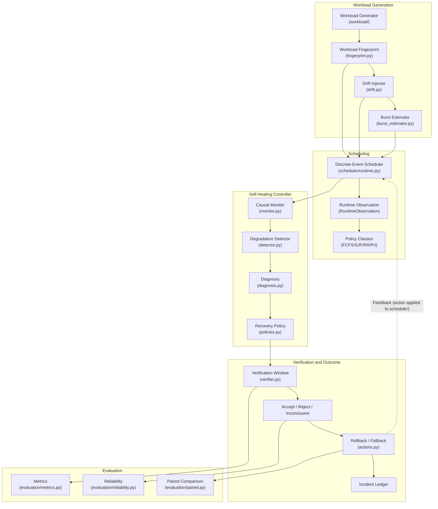
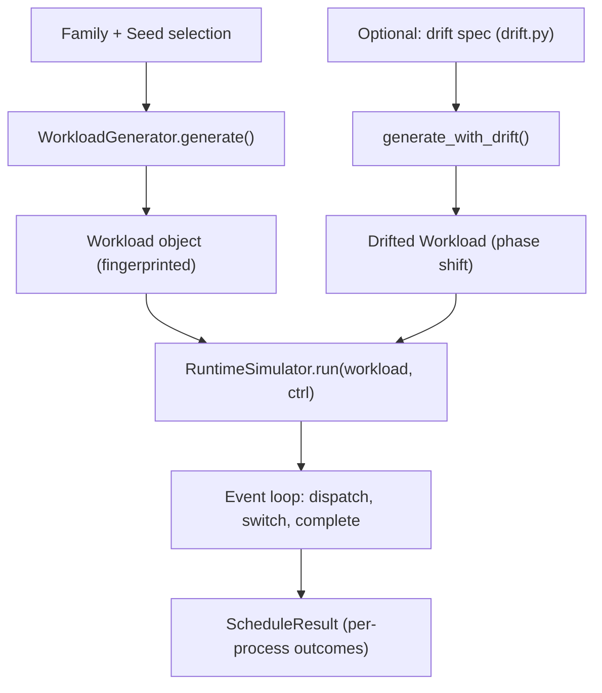
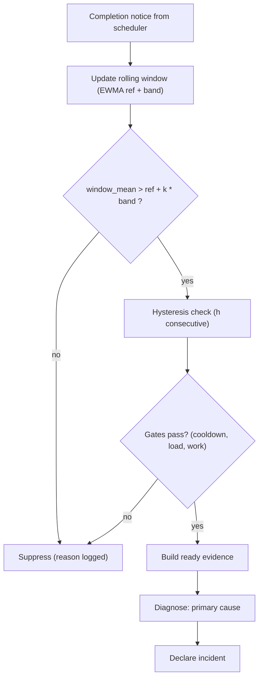
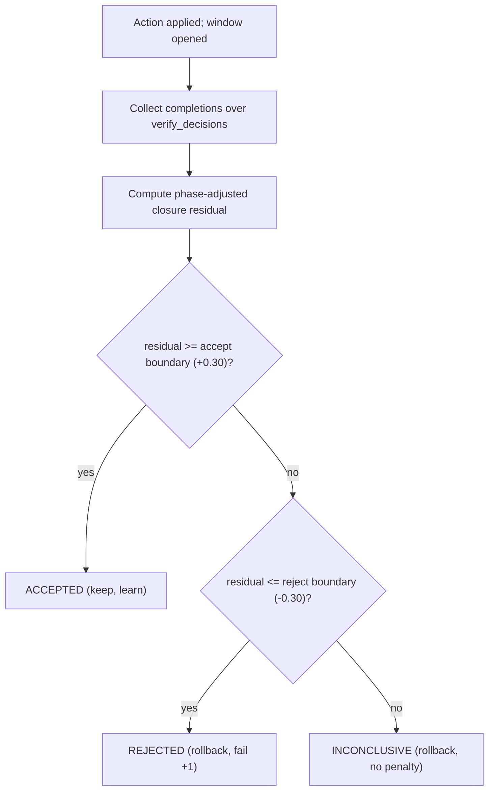
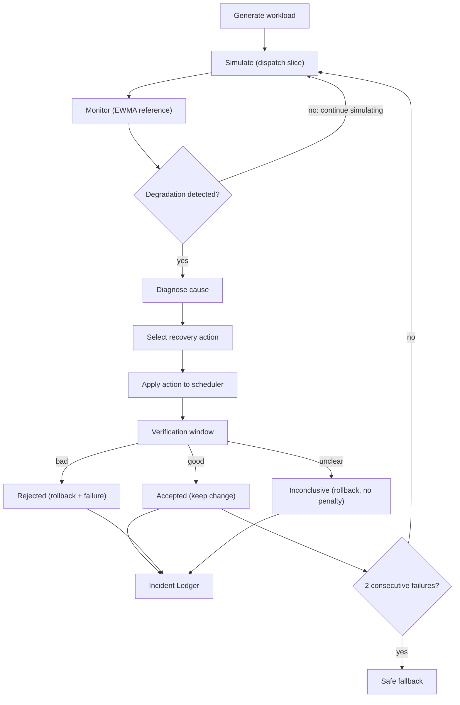
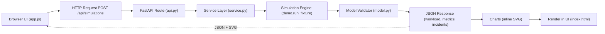

# Mermaid Source Code for All Figures

This file contains the Mermaid source code for all 7 figures in the paper. You can render these diagrams using any Mermaid-compatible tool (e.g., https://mermaid.live, VS Code Mermaid preview, or GitHub markdown).

---

## Figure 1. Experimental methodology pipeline

---

## Figure 2. Overall system architecture of the adaptive CPU scheduling pipeline

---

## Figure 3. Workload generation and scheduling workflow

---

## Figure 4. Degradation detection and diagnosis workflow

---

## Figure 5. Verification, acceptance, and rollback workflow

---

## Figure 6. Self-healing controller workflow (one trace)

---

## Figure 7. Frontend-to-backend simulation execution flow

---

## Notes

- All 7 figures are now in correct sequential order (1-7)
- Each figure appears in its corresponding section:
  - Figure 1: §9.6 Experimental Design
  - Figure 2: §10 Overall Conceptual and Architectural Diagram
  - Figure 3: §12.1 Workload Generation
  - Figure 4: §12.2 Degradation Detection
  - Figure 5: §12.3 Verification and Acceptance
  - Figure 6: §12.4 Self-Healing Loop
  - Figure 7: §12.5 Frontend-to-Backend Execution Flow
- To render: Copy the Mermaid code blocks into any Mermaid renderer
- These diagrams replace the original PNG images in the DOCX and PDF
